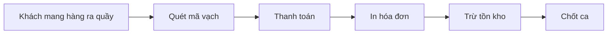

# Tổng quan nghiệp vụ — POS Cửa hàng Bán lẻ

> Mô tả demo này cho ai, giải quyết vấn đề gì. Cập nhật khi phạm vi thay đổi.

---

## 1. Thông tin chung

| Mục | Nội dung |
| :--- | :--- |
| Tên demo | POS Cửa hàng Bán lẻ |
| Mã dự án | `retail-pos-ban-le` |
| Ngành / loại khách hàng | Tạp hóa, mini mart, cửa hàng tiện lợi |
| Loại sản phẩm | Màn hình bán hàng (máy quét mã vạch) + web quản lý |
| Ý tưởng gốc | 2.3 · POS cửa hàng bán lẻ / tạp hóa / mini mart (`ZDOCS/02-KE-HOACH/DANH-SACH-Y-TUONG.md`) |
| Người phụ trách | Mạnh Hùng (Pum) |
| Trạng thái | Đã code BE + FE, chạy được cả hai chế độ (dữ liệu mẫu và BE thật trên Postgres) |
| Cửa hàng mẫu | Bình An Mart (hư cấu), một cửa hàng, hai quầy; demo online `https://pum-pos-ban-le.vercel.app` (dữ liệu mẫu) |

## 2. Vấn đề của khách hàng

- Phải nhớ giá hàng nghìn mặt hàng
- Tính tiền chậm, khách xếp hàng
- Không biết tồn kho thật
- Hàng sắp hết, sắp hết hạn không kiểm soát được

## 3. Giải pháp demo thể hiện

- Quét mã vạch tính tiền nhanh, tìm theo tên, nhiều hóa đơn chờ
- Đổi trả hàng, tính tiền thối
- Quản lý hàng hóa, giá, đơn vị tính
- Trừ tồn khi bán, cảnh báo sắp hết
- Báo cáo ca, doanh thu, lợi nhuận

## 4. Vai trò người dùng

| Vai trò | Mã | Dùng trên | Làm được gì |
| :--- | :--- | :--- | :--- |
| Quản trị viên | ADMIN | Desktop | Toàn quyền |
| Chủ cửa hàng | MANAGER | Desktop | Hàng hóa, giá, nhập hàng, báo cáo |
| Thu ngân | CASHIER | Máy bán hàng | Bán hàng, đổi trả, chốt ca |

## 5. Phân hệ và chức năng

| Area | Chức năng | Màn hình (route FE dự kiến) | Ưu tiên |
| :--- | :--- | :--- | :---: |
| `System` | Đăng nhập, tài khoản, vai trò, cài đặt | Có sẵn | — |
| `Pos` | Tổng quan trong ngày | `/dashboard` | P1 |
| `Pos` | Bán hàng quét mã vạch | `/pos` | P1 |
| `Pos` | Thanh toán, in hóa đơn | `/pos` (hộp thoại), `/pos/receipt/[id]` | P1 |
| `Pos` | Tra cứu, in lại hóa đơn | `/orders` | P2 |
| `Pos` | Đổi trả | `/returns` | P1 |
| `Pos` | Ca làm, báo cáo ca | `/shifts` | P1 |
| `Pos` | Mở ca, chốt ca tại quầy | `/shifts/current` | P1 |
| `Inventory` | Hàng hóa, đơn vị tính, giá | `/products` | P1 |
| `Inventory` | Tồn kho, cảnh báo | `/stock` | P2 |
| `Inventory` | Nhập hàng | `/goods-receipts` | P2 |
| `Inventory` | Lập, xem phiếu nhập | `/goods-receipts/[id]` | P2 |
| `Pos` | Báo cáo doanh thu, lợi nhuận | `/reports` | P2 |
| `Crm` | Khách thân thiết | `/customers` | P3 |

P1 = bắt buộc có để demo · P2 = nên có · P3 = làm thêm nếu còn thời gian.

## 6. Luồng nghiệp vụ chính

## 7. Phạm vi

**Có trong demo:**

- Bán hàng bằng bàn phím hoặc máy quét (máy quét hoạt động như bàn phím)
- Hàng hóa, tồn kho, báo cáo

**Không làm (nói rõ với khách nếu được hỏi):**

- Máy in, két tiền thật
- Hóa đơn điện tử thật
- Các kết nối bên ngoài khác chỉ giả lập

## 8. Dữ liệu mẫu cần chuẩn bị

| Dữ liệu | Số lượng | Ghi chú |
| :--- | :---: | :--- |
| Nhóm hàng | 10 |  |
| Hàng hóa | 300 | Có mã vạch, giá vốn, giá bán |
| Hóa đơn | ~5.000 | 90 ngày |
| Phiếu nhập | 40 |  |
