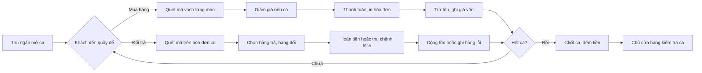
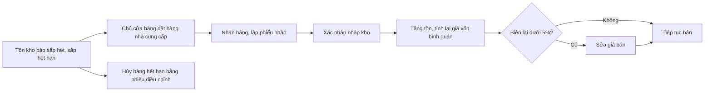
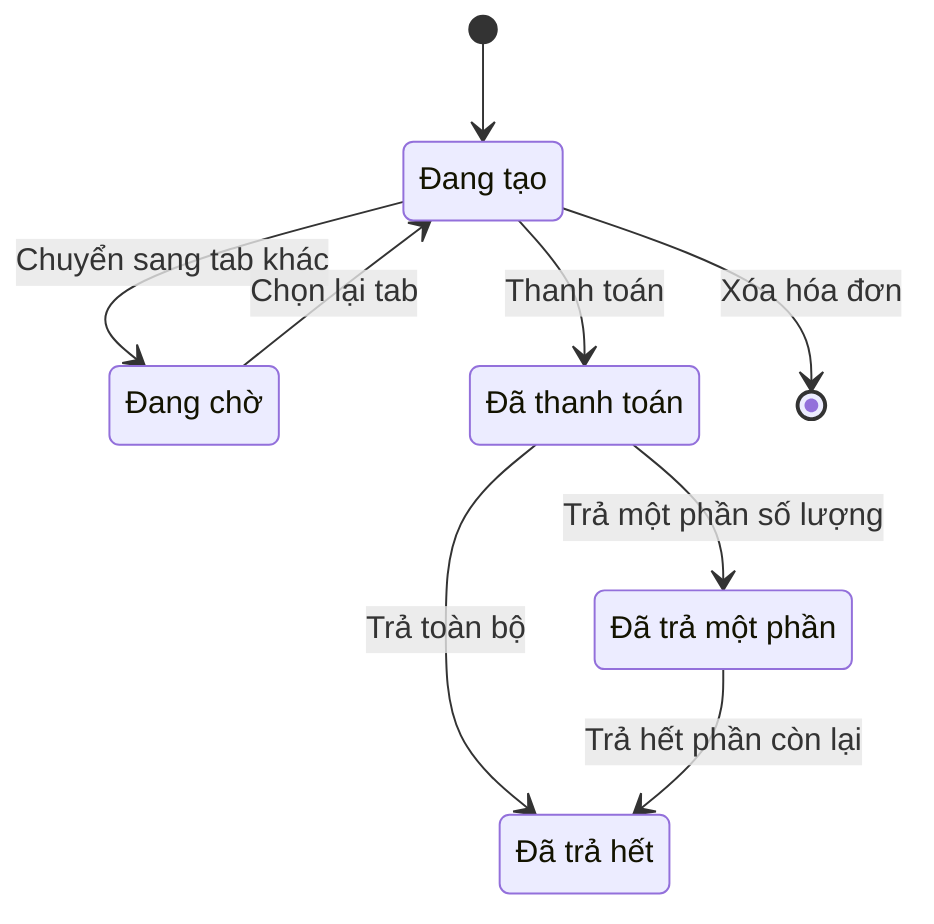
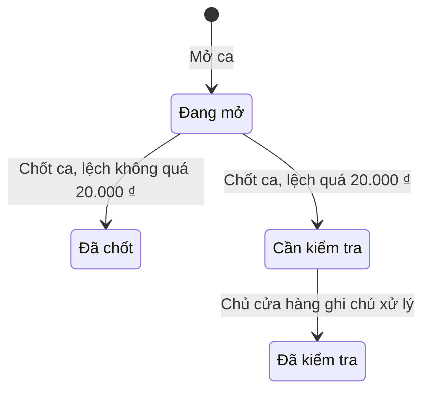
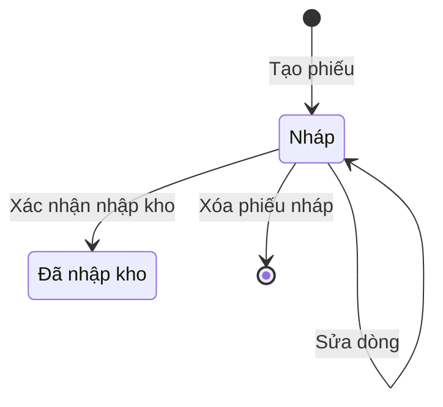

# Đặc tả yêu cầu phần mềm (SRS) — POS Cửa hàng Bán lẻ

| Phiên bản | Ngày | Trạng thái |
| :--- | :--- | :--- |
| 1.0 | 12/10/2026 | Bản nháp để triển khai demo |

> Cách viết, quy ước mã, mức độ chi tiết: `ZDOCS/05-HUONG-DAN/HUONG-DAN-VIET-TAI-LIEU-NGHIEP-VU.md`.
> Phần nền (đăng nhập, tài khoản, vai trò, cài đặt, đặt lại dữ liệu demo): `ZDOCS/03-KIEN-TRUC/USE-CASE-NEN.md`, không viết lại ở đây.

---

## 1. Giới thiệu

### 1.1. Mục đích

Tài liệu mô tả đầy đủ yêu cầu của bản demo POS Cửa hàng Bán lẻ: chức năng, quy tắc tính tiền, quy đổi đơn vị, giá vốn, đổi trả, tồn kho, báo cáo lợi nhuận, phân quyền và màn hình. Dev dùng để code, tester dùng để viết và chạy test case, sales dùng để biết demo làm được gì.

### 1.2. Phạm vi

**Trong phạm vi:** hàng hóa với đơn vị quy đổi (lon, lốc, thùng) và mã vạch riêng từng đơn vị, bán hàng bằng máy quét mã vạch, nhiều hóa đơn chờ, giảm giá có xác nhận của chủ cửa hàng, thanh toán tiền mặt, chuyển khoản QR và thẻ, in hóa đơn qua trình duyệt, đổi trả hàng, ca làm và đối soát tiền mặt, tồn kho với cảnh báo sắp hết và sắp hết hạn, điều chỉnh tồn, nhập hàng với giá vốn bình quân gia quyền, báo cáo doanh thu và lợi nhuận gộp, khách thân thiết (P3).

**Ngoài phạm vi:** máy in bill, két tiền, máy quẹt thẻ thật (chỉ giả lập); cổng thanh toán thật; hóa đơn điện tử; hàng cân ký dùng mã vạch in từ cân điện tử; khuyến mãi tự động (mua X tặng Y, giá theo khung giờ); bán chịu, công nợ khách hàng và nhà cung cấp; nhiều cửa hàng, nhiều kho, chuyển kho, kiểm kê toàn kho (xem demo Quản lý Kho); bán hàng online.

### 1.3. Thuật ngữ

| Thuật ngữ | Giải thích |
| :--- | :--- |
| Mặt hàng | Sản phẩm cửa hàng bán, vd "Bia lager lon 330ml"; mỗi mặt hàng có một mã hàng |
| Đơn vị cơ bản | Đơn vị nhỏ nhất bán được, dùng để tính tồn và giá vốn, vd Lon |
| Đơn vị quy đổi | Đơn vị lớn hơn của cùng mặt hàng, có mã vạch và giá bán riêng, vd Lốc 6, Thùng 24 |
| Hệ số quy đổi | Số đơn vị cơ bản trong một đơn vị quy đổi; Thùng 24 có hệ số 24 |
| Số lượng quy đổi | Số lượng tính về đơn vị cơ bản = số lượng × hệ số quy đổi |
| Mã vạch | Dãy số in trên bao bì (EAN-13, EAN-8, UPC) hoặc mã nội bộ cửa hàng tự in; mỗi đơn vị một mã |
| Hóa đơn chờ | Hóa đơn đang tạo, nằm ở một tab của màn bán hàng, chưa thanh toán |
| Hóa đơn | Hóa đơn đã thanh toán |
| Giá vốn bình quân | Giá vốn một đơn vị cơ bản, tính lại theo bình quân gia quyền sau mỗi lần nhập |
| Giá vốn hàng bán | Tổng giá vốn của các dòng hóa đơn trong kỳ |
| Doanh thu thuần | Tổng thanh toán của hóa đơn trừ tiền hoàn của phiếu đổi trả |
| Lợi nhuận gộp | Doanh thu thuần trừ giá vốn hàng bán thuần |
| Biên lãi | (Giá bán − giá vốn) ÷ giá bán, tính cho một mặt hàng ở đơn vị cơ bản |
| Phiếu đổi trả | Chứng từ ghi hàng khách trả lại, hàng đổi và tiền hoàn |
| Hàng đổi | Hàng khách lấy thay cho hàng trả, lập thành một hóa đơn mới gắn với phiếu đổi trả |
| Tiền hoàn | Số tiền cửa hàng trả lại khách cho hàng trả |
| Hàng lỗi | Hàng trả không bán lại được (móp, phồng, hỏng), không cộng vào tồn |
| Tồn tối thiểu | Mức tồn mà từ đó trở xuống hàng được coi là sắp hết |
| Âm kho | Tồn trên hệ thống nhỏ hơn 0 do bán hàng chưa nhập vào hệ thống |
| Lô | Một dòng phiếu nhập của mặt hàng có quản lý hạn sử dụng |
| Phiếu điều chỉnh tồn | Chứng từ tăng hoặc giảm tồn khi hàng hỏng, hết hạn, mất hoặc đếm lại |
| Ca | Khoảng thời gian một thu ngân bán hàng, từ lúc mở ca đến lúc chốt ca |
| Tiền mặt lý thuyết | Số tiền mặt hệ thống tính được phải có trong két lúc chốt ca |
| Chênh lệch ca | Tiền mặt thực đếm trừ tiền mặt lý thuyết |
| Xác nhận của chủ cửa hàng | Chủ cửa hàng nhập tài khoản ngay trên máy bán hàng để cho phép thao tác vượt quyền thu ngân |

### 1.4. Tài liệu liên quan

| Tài liệu | Nội dung |
| :--- | :--- |
| `01-TONG-QUAN-NGHIEP-VU.md` | Tổng quan nghiệp vụ |
| `03-USE-CASE.md` | Đặc tả use case |
| `05-KICH-BAN-KIEM-THU.md` | Test case nghiệm thu |
| `ZDOCS/03-KIEN-TRUC/USE-CASE-NEN.md` | Phần nền dùng chung |

---

## 2. Mô tả tổng quan

### 2.1. Bối cảnh sản phẩm

Tạp hóa, mini mart, cửa hàng tiện lợi có 300–3.000 mặt hàng, 1–2 quầy thu ngân. Mỗi quầy gồm máy tính hoặc màn cảm ứng 15", máy quét mã vạch, máy in bill 80 mm hoặc 58 mm, két tiền. Thu ngân quét mã, thu tiền, in bill, nhận đổi trả. Chủ cửa hàng quản lý hàng hóa, giá, nhập hàng, theo dõi tồn và lãi lỗ trên máy tính hoặc điện thoại. Bản demo chạy một cửa hàng, một kho.

### 2.2. Tác nhân

| Mã vai trò | Tên | Thiết bị | Mục tiêu khi dùng hệ thống |
| :--- | :--- | :--- | :--- |
| `ADMIN` | Quản trị viên | Desktop | Cấu hình hệ thống, tài khoản, phân quyền, cài đặt in và bán âm kho |
| `MANAGER` | Chủ cửa hàng | Desktop, điện thoại | Hàng hóa, giá, nhập hàng, tồn kho, kiểm tra ca, xem lãi lỗ, xác nhận giảm giá và đổi trả vượt quyền |
| `CASHIER` | Thu ngân | Máy bán hàng có máy quét | Tính tiền nhanh và đúng, đổi trả cho khách, chốt ca không lệch |

Tài khoản demo: `admin`, `quanly`, `thungan` (có nút Đăng nhập nhanh) và `thungan2` (thu ngân thứ hai trong dữ liệu mẫu). Vai trò `STAFF` và tài khoản `nhanvien` của phần nền không dùng trong dự án này.

### 2.3. Quy trình nghiệp vụ

**Bán hàng và đổi trả trong ca**

**Nhập hàng và kiểm soát tồn**

### 2.4. Giả định và ràng buộc

- Một cửa hàng, một kho, 1–2 quầy; mỗi thu ngân dùng một tài khoản riêng.
- Máy quét mã vạch USB hoặc không dây chạy ở chế độ giả lập bàn phím: gửi dãy số kèm phím Enter. Không cần driver. Trong demo gõ mã vạch bằng bàn phím thay máy quét.
- Giá bán đã gồm thuế, hóa đơn không tách thuế GTGT. Giá bán là bội số của 500 ₫.
- Hàng bán theo đơn vị đếm được; không hỗ trợ hàng bán theo cân.
- Két tiền, máy in bill, máy quẹt thẻ và QR chuyển khoản là giả lập. In bằng lệnh in của trình duyệt.
- Cài đặt riêng của dự án nằm trong Cài đặt chung (UC-SYS-07): khổ giấy in (80 mm hoặc 58 mm), cho phép bán âm kho (mặc định bật), tiền đầu ca mặc định (500.000 ₫), dòng chính sách đổi trả in cuối hóa đơn.

---

## 3. Yêu cầu chức năng

### 3.1. Tổng quan

| Mã | Yêu cầu | Ưu tiên | Vai trò | UC |
| :--- | :--- | :---: | :--- | :--- |
| FR-01 | Hệ thống hiển thị doanh thu thuần hôm nay, lợi nhuận gộp, số hóa đơn, giá trị trung bình một hóa đơn và mức tăng giảm so với cùng giờ hôm qua | P1 | MANAGER | UC-11 |
| FR-02 | Hệ thống hiển thị biểu đồ doanh thu thuần và lợi nhuận gộp 7 ngày gần nhất, top 10 mặt hàng bán chạy hôm nay, số mặt hàng sắp hết và số lô sắp hết hạn; bấm vào số thì mở Tồn kho đã lọc sẵn | P1 | MANAGER | UC-11 |

### 3.2. Hàng hóa

| Mã | Yêu cầu | Ưu tiên | Vai trò | UC |
| :--- | :--- | :---: | :--- | :--- |
| FR-03 | Hệ thống cho phép chủ cửa hàng thêm, sửa, ẩn/hiện nhóm hàng | P1 | MANAGER | UC-01 |
| FR-04 | Hệ thống cho phép chủ cửa hàng thêm, sửa mặt hàng với tên, nhóm, đơn vị cơ bản, mã vạch, giá bán, giá vốn ban đầu, tồn tối thiểu, có quản lý hạn sử dụng hay không, có cho đổi trả hay không, trạng thái (đang bán, ngừng bán) | P1 | MANAGER | UC-01 |
| FR-05 | Hệ thống cho phép khai báo tối đa 3 đơn vị quy đổi cho mỗi mặt hàng, mỗi đơn vị có tên, hệ số quy đổi, mã vạch riêng, giá bán riêng | P1 | MANAGER | UC-01 |
| FR-06 | Danh sách hàng hóa tìm được theo tên (gõ không dấu), mã hàng, mã vạch; lọc theo nhóm, trạng thái; hiển thị giá bán, giá vốn bình quân, biên lãi, tồn | P1 | MANAGER | UC-01 |
| FR-07 | Hệ thống sinh mã vạch nội bộ cho mặt hàng chưa có mã và in tem mã vạch kèm tên, giá khổ 40×30 mm qua trình duyệt | P3 | MANAGER | UC-01 |

### 3.3. Bán hàng

| Mã | Yêu cầu | Ưu tiên | Vai trò | UC |
| :--- | :--- | :---: | :--- | :--- |
| FR-08 | Màn bán hàng luôn đặt con trỏ ở ô quét; quét hoặc gõ mã vạch rồi Enter thì hệ thống thêm đúng mặt hàng và đúng đơn vị ứng với mã đó, số lượng 1 | P1 | CASHIER | UC-03 |
| FR-09 | Thu ngân gõ `số lượng*` trước khi quét (vd `12*`) để thêm nhiều đơn vị trong một lần quét | P1 | CASHIER | UC-03 |
| FR-10 | Thu ngân tìm hàng theo tên hoặc mã hàng, gõ không dấu; danh sách gợi ý hiển thị từng đơn vị kèm giá để chọn | P1 | CASHIER | UC-03 |
| FR-11 | Giỏ hàng cho phép sửa số lượng, đổi đơn vị của dòng (giá cập nhật theo đơn vị mới), xóa dòng; hiển thị tổng số lượng và tổng tiền | P1 | CASHIER | UC-03 |
| FR-12 | Thu ngân mở tối đa 5 hóa đơn chờ dạng tab để phục vụ song song nhiều khách, chuyển qua lại không mất dữ liệu | P1 | CASHIER | UC-03 |
| FR-13 | Hệ thống cảnh báo trên dòng khi số lượng bán vượt tồn; chặn hoặc cho bán tùy cài đặt "Cho phép bán âm kho" | P2 | CASHIER | UC-03 |
| FR-14 | Thu ngân kiểm tra giá: quét mã để xem tên, giá mọi đơn vị, tồn hiện tại mà không thêm vào giỏ | P2 | CASHIER | UC-04 |
| FR-15 | Thu ngân giảm giá theo dòng hoặc toàn hóa đơn, theo phần trăm hoặc số tiền, có chọn lý do | P1 | CASHIER | UC-05 |
| FR-16 | Giảm giá vượt hạn mức của thu ngân, hoặc làm hóa đơn bán dưới giá vốn, cần chủ cửa hàng xác nhận bằng tài khoản ngay trên máy bán hàng | P1 | CASHIER, MANAGER | UC-05 |

### 3.4. Thanh toán và hóa đơn

| Mã | Yêu cầu | Ưu tiên | Vai trò | UC |
| :--- | :--- | :---: | :--- | :--- |
| FR-17 | Thanh toán tiền mặt: thu ngân nhập tiền khách đưa hoặc bấm mức gợi ý, hệ thống hiển thị tiền thối và gửi lệnh mở két (giả lập) | P1 | CASHIER | UC-06 |
| FR-18 | Thanh toán chuyển khoản (QR giả lập theo VietQR, có số tiền, nội dung là mã hóa đơn) hoặc thẻ ngân hàng (quẹt trên máy POS của ngân hàng, ngoài hệ thống); thu ngân bấm xác nhận đã nhận tiền | P1 | CASHIER | UC-06 |
| FR-19 | Khi hóa đơn thanh toán, hệ thống trừ tồn theo số lượng quy đổi và lưu giá vốn của từng dòng | P1 | CASHIER | UC-06 |
| FR-20 | Hệ thống mở bản in hóa đơn khổ 80 mm hoặc 58 mm gồm thông tin cửa hàng, mã hóa đơn, thời gian, thu ngân, tên hàng, đơn vị, số lượng, đơn giá, giảm giá, tổng tiền, phương thức, tiền khách đưa, tiền thối, chính sách đổi trả và mã vạch của mã hóa đơn | P1 | CASHIER | UC-06 |
| FR-21 | Thu ngân và chủ cửa hàng tra cứu hóa đơn, phiếu đổi trả theo mã, khoảng thời gian, thu ngân, phương thức; xem chi tiết kèm chứng từ liên quan; in lại | P2 | CASHIER, MANAGER | UC-08 |

### 3.5. Đổi trả

| Mã | Yêu cầu | Ưu tiên | Vai trò | UC |
| :--- | :--- | :---: | :--- | :--- |
| FR-22 | Thu ngân mở hóa đơn gốc bằng cách quét mã vạch in trên hóa đơn hoặc gõ mã hóa đơn; hệ thống hiển thị các dòng còn trả được và số lượng tối đa | P1 | CASHIER | UC-07 |
| FR-23 | Thu ngân chọn dòng, số lượng trả, tình trạng hàng (Bán lại được, Hàng lỗi), lý do; hệ thống tính tiền hoàn từng dòng và tổng | P1 | CASHIER | UC-07 |
| FR-24 | Thu ngân thêm hàng đổi vào cùng phiếu bằng quét mã; hệ thống tính chênh lệch, cho thu thêm hoặc hoàn tiền | P1 | CASHIER | UC-07 |
| FR-25 | Trả hàng của hóa đơn quá 7 ngày, hoặc tổng tiền hoàn trên 500.000 ₫, cần chủ cửa hàng xác nhận | P1 | CASHIER, MANAGER | UC-07 |
| FR-26 | Khi lưu phiếu đổi trả, hệ thống cộng tồn hàng "Bán lại được", ghi hàng lỗi vào sổ hàng lỗi và mở bản in phiếu đổi trả có chỗ ký của khách | P1 | CASHIER | UC-07 |

### 3.6. Ca làm

| Mã | Yêu cầu | Ưu tiên | Vai trò | UC |
| :--- | :--- | :---: | :--- | :--- |
| FR-27 | Thu ngân mở ca bằng cách nhập tiền đầu ca; khi chưa mở ca, màn bán hàng và chức năng lập phiếu đổi trả bị khóa | P1 | CASHIER | UC-02 |
| FR-28 | Khi chốt ca, hệ thống tổng hợp số hóa đơn, doanh thu theo phương thức, số phiếu đổi trả, tiền hoàn theo phương thức, tiền mặt lý thuyết; thu ngân nhập tiền đếm theo mệnh giá; hệ thống tính chênh lệch và in báo cáo ca khổ 80 mm | P1 | CASHIER | UC-09 |
| FR-29 | Chủ cửa hàng xem danh sách ca, lọc ca "Cần kiểm tra", xem hóa đơn và phiếu đổi trả của từng ca, ghi chú xử lý và đánh dấu đã kiểm tra | P1 | MANAGER | UC-10 |

### 3.7. Tồn kho

| Mã | Yêu cầu | Ưu tiên | Vai trò | UC |
| :--- | :--- | :---: | :--- | :--- |
| FR-30 | Danh sách tồn kho hiển thị tồn theo đơn vị cơ bản kèm cách đọc quy đổi (vd "2 thùng 2 lon"), giá vốn bình quân, giá trị tồn, trạng thái; lọc theo nhóm, trạng thái; có tổng giá trị tồn | P2 | MANAGER | UC-12 |
| FR-31 | Tab "Sắp hết hạn" liệt kê lô còn hàng có hạn sử dụng trong 30 ngày tới và lô đã hết hạn, kèm số lượng còn lại ước tính | P2 | MANAGER | UC-12 |
| FR-32 | Chủ cửa hàng xem lịch sử biến động tồn của một mặt hàng: thời gian, chứng từ (bán, trả, nhập, điều chỉnh), số lượng tăng giảm, tồn sau, giá vốn sau | P2 | MANAGER | UC-12 |
| FR-33 | Chủ cửa hàng lập phiếu điều chỉnh tồn khi hàng hỏng, hết hạn, mất hoặc đếm lại: nhập số lượng thực tế và lý do; hệ thống tính chênh lệch và giá trị | P2 | MANAGER | UC-13 |

### 3.8. Nhập hàng

| Mã | Yêu cầu | Ưu tiên | Vai trò | UC |
| :--- | :--- | :---: | :--- | :--- |
| FR-34 | Chủ cửa hàng tạo phiếu nhập: chọn hoặc thêm nhanh nhà cung cấp, thêm dòng bằng quét mã hoặc tìm tên, chọn đơn vị, nhập số lượng, đơn giá nhập, hạn sử dụng (với hàng có quản lý hạn); lưu nháp | P2 | MANAGER | UC-14 |
| FR-35 | Khi xác nhận nhập kho, hệ thống tăng tồn, tính lại giá vốn bình quân và liệt kê mặt hàng có biên lãi dưới 5% để chủ cửa hàng sửa giá bán ngay | P2 | MANAGER | UC-14 |

### 3.9. Báo cáo

| Mã | Yêu cầu | Ưu tiên | Vai trò | UC |
| :--- | :--- | :---: | :--- | :--- |
| FR-36 | Báo cáo doanh thu theo ngày: doanh thu bán, tiền hoàn, doanh thu thuần, giá vốn hàng bán thuần, lợi nhuận gộp, biên lãi gộp, so với kỳ liền trước cùng độ dài; kèm tab theo thu ngân và theo phương thức thanh toán | P2 | MANAGER | UC-15 |
| FR-37 | Báo cáo lợi nhuận theo nhóm hàng và theo mặt hàng; xếp hạng bán chạy theo số lượng, doanh thu thuần hoặc lợi nhuận gộp | P2 | MANAGER | UC-15 |
| FR-38 | Báo cáo đổi trả và hàng lỗi: số phiếu, tiền hoàn theo lý do, số lượng và giá trị hàng lỗi, hàng hủy qua phiếu điều chỉnh | P2 | MANAGER | UC-15 |
| FR-39 | Xuất báo cáo đang xem ra file Excel | P3 | MANAGER | UC-15 |

### 3.10. Khách hàng

| Mã | Yêu cầu | Ưu tiên | Vai trò | UC |
| :--- | :--- | :---: | :--- | :--- |
| FR-40 | Thu ngân gắn khách vào hóa đơn theo số điện thoại hoặc thêm nhanh khách mới; hệ thống cộng điểm khi thanh toán, trừ điểm khi trả hàng; chủ cửa hàng xem danh sách khách, điểm, lịch sử mua | P3 | CASHIER, MANAGER | UC-16 |

---

## 4. Quy tắc nghiệp vụ

| Mã | Quy tắc | Áp dụng cho |
| :--- | :--- | :--- |
| BR-01 | Tồn kho và giá vốn lưu theo đơn vị cơ bản (hệ số 1). Đơn vị quy đổi có hệ số nguyên từ 2 đến 1.000. Số lượng quy đổi = số lượng × hệ số. Bán 1 Thùng 24 trừ 24 lon khỏi tồn | FR-05, FR-19 |
| BR-02 | Cách đọc tồn quy đổi: chia lần lượt cho đơn vị có hệ số lớn nhất tới nhỏ nhất, bỏ phần bằng 0. Bia lon có Lốc 6, Thùng 24: tồn 50 đọc là "2 thùng 2 lon", tồn 32 đọc là "1 thùng 1 lốc 2 lon". Tồn âm chỉ hiển thị số đơn vị cơ bản, vd "−3 lon" | FR-14, FR-30 |
| BR-03 | Mã vạch chỉ gồm chữ số, dài 8–14 ký tự, không trùng giữa mọi đơn vị của mọi mặt hàng (kể cả hàng ngừng bán). Mã nội bộ do hệ thống sinh có 13 số: `20` + 10 số thứ tự + 1 số kiểm tra EAN-13, vd `2000000000015` | FR-04, FR-05, FR-07 |
| BR-04 | Giá bán là bội số của 500 ₫ và lớn hơn 0. Giá đơn vị quy đổi nhập riêng; nếu lớn hơn giá đơn vị cơ bản × hệ số thì hệ thống cảnh báo "Mua theo đơn vị lớn đắt hơn mua lẻ" nhưng vẫn cho lưu | FR-04, FR-05 |
| BR-05 | Quét mã thêm dòng đúng mặt hàng và đơn vị của mã. Giỏ đã có dòng cùng mặt hàng, cùng đơn vị và chưa giảm giá dòng thì cộng số lượng vào dòng đó. Tiền tố `n*` nhận n nguyên từ 1 đến 999, chỉ áp cho lần quét hoặc lần chọn kế tiếp rồi trở về 1. Mã không tồn tại hoặc thuộc hàng ngừng bán thì phát âm báo lỗi và không thêm dòng | FR-08, FR-09, FR-10 |
| BR-06 | Thành tiền dòng = giá bán của đơn vị × số lượng. Đổi đơn vị của dòng thì giữ nguyên số lượng, lấy giá của đơn vị mới | FR-11 |
| BR-07 | Tổng thanh toán = tổng thành tiền − tổng giảm giá dòng − giảm giá hóa đơn; không nhỏ hơn 0. Giảm theo phần trăm làm tròn xuống tới bội số 500 ₫ | FR-11, FR-15 |
| BR-08 | Thu ngân tự giảm tối đa 5% tổng tiền hàng của hóa đơn (cộng cả giảm dòng và giảm hóa đơn); vượt mức cần chủ cửa hàng xác nhận | FR-15, FR-16 |
| BR-09 | Bán dưới giá vốn: nếu tổng thanh toán nhỏ hơn tổng giá vốn dự kiến của hóa đơn (tổng số lượng quy đổi × giá vốn bình quân hiện tại) thì cần chủ cửa hàng xác nhận, kể cả khi mức giảm nằm trong hạn mức | FR-16 |
| BR-10 | Bán vượt tồn: khi tổng số lượng quy đổi của một mặt hàng trong hóa đơn lớn hơn tồn hiện tại, dòng được tô cam "Vượt tồn {n} {đơn vị cơ bản}". Cài đặt "Cho phép bán âm kho" bật thì vẫn thanh toán được; tắt thì nút Thanh toán bị khóa | FR-13 |
| BR-11 | Mỗi máy bán hàng có tối đa 5 hóa đơn chờ. Hóa đơn chờ lưu trên trình duyệt của máy, giữ nguyên khi tải lại trang. Khi chốt ca còn hóa đơn chờ có hàng thì hệ thống yêu cầu thanh toán hoặc xóa trước | FR-12, FR-28 |
| BR-12 | Thanh toán tiền mặt: tiền khách đưa phải lớn hơn hoặc bằng tổng thanh toán; tiền thối = tiền khách đưa − tổng thanh toán. Mức gợi ý gồm tổng thanh toán và các mức làm tròn lên tới bội số 10.000 ₫, 50.000 ₫, 100.000 ₫, 500.000 ₫, bỏ mức trùng. Tổng 84.500 ₫ có gợi ý 84.500 ₫, 90.000 ₫, 100.000 ₫, 500.000 ₫ | FR-17 |
| BR-13 | Giá vốn dòng hóa đơn = số lượng quy đổi × giá vốn bình quân tại thời điểm thanh toán; lưu cố định trên dòng, không đổi khi giá vốn thay đổi sau đó | FR-19 |
| BR-14 | Giảm giá hóa đơn được phân bổ cho các dòng theo tỉ lệ (thành tiền − giảm giá dòng), làm tròn tới 1 ₫, dòng cuối nhận phần còn lại. Doanh thu thuần dòng = thành tiền − giảm giá dòng − giảm giá phân bổ. Vd hóa đơn 1 thùng bia 410.000 ₫ và 1 thùng mì 120.000 ₫, giảm hóa đơn 26.500 ₫: dòng bia nhận 20.500 ₫, dòng mì nhận 6.000 ₫ | FR-19, FR-23, FR-36 |
| BR-15 | Hóa đơn đã thanh toán không sửa, không hủy. Mọi điều chỉnh sau thanh toán đi qua phiếu đổi trả để giữ dấu vết tiền và tồn | FR-21, FR-22 |
| BR-16 | Mã chứng từ theo §5.3. Số thứ tự đếm lại từ 1 mỗi ngày | FR-20, FR-26, FR-28, FR-33, FR-34 |
| BR-17 | Điều kiện đổi trả: mặt hàng có "Cho đổi trả". Thời hạn tính theo ngày lịch, ngày mua là ngày 0: từ 0 đến 7 ngày thu ngân tự xử lý; từ 8 đến 30 ngày cần chủ cửa hàng xác nhận; quá 30 ngày không nhận. Số lượng trả tính theo đơn vị trên dòng gốc, không vượt số lượng mua trừ số lượng đã trả trước đó | FR-22, FR-23, FR-25 |
| BR-18 | Tiền hoàn dòng = doanh thu thuần dòng gốc ÷ số lượng mua × số lượng trả, làm tròn xuống tới bội số 500 ₫. Riêng lần trả hết số lượng còn lại của dòng thì tiền hoàn = doanh thu thuần dòng − tiền đã hoàn của dòng trước đó. Tổng tiền hoàn của phiếu lớn hơn 500.000 ₫ thì cần chủ cửa hàng xác nhận | FR-23, FR-25 |
| BR-19 | Hàng trả "Bán lại được" được cộng lại tồn theo số lượng quy đổi; giá vốn bình quân tính lại theo BR-23 với đơn giá bằng giá vốn đơn vị ghi trên dòng gốc. "Hàng lỗi" không cộng tồn; ghi vào sổ hàng lỗi với giá trị = số lượng quy đổi × giá vốn đơn vị trên dòng gốc | FR-26 |
| BR-20 | Đổi hàng: hàng đổi lập thành một hóa đơn mới gắn với phiếu đổi trả. Chênh lệch = tổng thanh toán hóa đơn mới − tổng tiền hoàn. Chênh lệch dương thì khách trả thêm qua hộp thanh toán; âm thì cửa hàng hoàn phần chênh; bằng 0 thì không thu chi. Phần tiền hoàn dùng để trừ vào hóa đơn mới ghi phương thức "Bù trừ đổi hàng" ở cả hai chứng từ, không tính vào tiền mặt | FR-24 |
| BR-21 | Không bán hàng, không lập phiếu đổi trả khi thu ngân chưa mở ca. Mỗi thu ngân tối đa một ca đang mở. Tiền mặt lý thuyết = tiền đầu ca + tiền mặt thu từ hóa đơn trong ca (đã trừ tiền thối) − tiền hoàn bằng tiền mặt của phiếu đổi trả trong ca | FR-27, FR-28 |
| BR-22 | Chênh lệch ca = tiền mặt thực đếm − tiền mặt lý thuyết. Trị tuyệt đối của chênh lệch lớn hơn 20.000 ₫ thì ca có trạng thái "Cần kiểm tra" và thu ngân bắt buộc ghi chú khi chốt | FR-28, FR-29 |
| BR-23 | Giá vốn bình quân gia quyền: giá vốn mới = (tồn hiện tại × giá vốn hiện tại + số lượng nhập quy đổi × đơn giá quy đổi) ÷ (tồn hiện tại + số lượng nhập quy đổi), làm tròn tới 1 ₫. Đơn giá quy đổi = đơn giá nhập của đơn vị ÷ hệ số. Nếu tồn hiện tại nhỏ hơn hoặc bằng 0 thì giá vốn mới = đơn giá quy đổi. Các dòng cùng mặt hàng trong một phiếu tính lần lượt theo thứ tự dòng. Bán hàng và điều chỉnh tồn không làm đổi giá vốn | FR-26, FR-35 |
| BR-24 | Phiếu nhập ở trạng thái Nháp sửa và xóa được; Đã nhập kho thì không sửa, không xóa, sai thì dùng phiếu điều chỉnh tồn. Số lượng nguyên lớn hơn 0; đơn giá nhập lớn hơn hoặc bằng 0 (0 là hàng nhà cung cấp tặng kèm). Hàng có quản lý hạn sử dụng bắt buộc nhập hạn sử dụng sau ngày nhập | FR-34, FR-35 |
| BR-25 | Biên lãi = (giá bán đơn vị cơ bản − giá vốn bình quân) ÷ giá bán đơn vị cơ bản × 100%, làm tròn 1 chữ số thập phân. Biên lãi dưới 5% thì tô cam ở danh sách hàng hóa và được liệt kê sau khi xác nhận nhập kho | FR-06, FR-35 |
| BR-26 | Trạng thái tồn: Âm kho (tồn < 0), Hết hàng (tồn = 0), Sắp hết (0 < tồn ≤ tồn tối thiểu), Còn hàng (tồn > tồn tối thiểu). Hàng ngừng bán không tính vào cảnh báo | FR-02, FR-30 |
| BR-27 | Mỗi dòng phiếu nhập của hàng có quản lý hạn sử dụng là một lô. Số lượng còn lại ước tính của lô: lấy tồn hiện tại chia cho các lô từ ngày nhập mới nhất về cũ nhất, mỗi lô nhận tối đa số lượng nhập của lô (hàng nhập trước coi như bán trước). Lô "Sắp hết hạn" khi còn lại > 0 và hạn sử dụng trong vòng 30 ngày tính từ hôm nay; "Đã hết hạn" khi còn lại > 0 và hạn sử dụng trước hôm nay | FR-02, FR-31 |
| BR-28 | Phiếu điều chỉnh tồn: chênh lệch = số lượng thực tế − tồn hệ thống; giá trị = chênh lệch × giá vốn bình quân; không làm đổi giá vốn. Lý do bắt buộc: Hỏng, Hết hạn, Mất, Đếm lại, Khác (kèm ghi chú). Phiếu lưu là áp dụng ngay, không sửa | FR-33 |
| BR-29 | Mặt hàng đã có chứng từ không xóa được, chỉ chuyển "Ngừng bán". Đơn vị quy đổi đã có trong chứng từ không xóa được, không đổi được hệ số | FR-04, FR-05 |
| BR-30 | Doanh thu thuần của kỳ = tổng thanh toán của hóa đơn trong kỳ − tổng tiền hoàn của phiếu đổi trả lập trong kỳ. Giá vốn hàng bán thuần = tổng giá vốn dòng hóa đơn − giá vốn của hàng trả (mọi tình trạng). Lợi nhuận gộp = doanh thu thuần − giá vốn hàng bán thuần. Biên lãi gộp = lợi nhuận gộp ÷ doanh thu thuần. Hàng lỗi và hàng hủy báo cáo riêng, không trừ vào lợi nhuận gộp | FR-01, FR-36, FR-37, FR-38 |
| BR-31 | Tích điểm: 1 điểm cho mỗi 20.000 ₫ tổng thanh toán, làm tròn xuống. Trả hàng trừ số điểm = tiền hoàn ÷ 20.000, làm tròn xuống; điểm không âm | FR-40 |

---

## 5. Yêu cầu dữ liệu

### 5.1. Thực thể

| Thực thể | Mô tả | Thuộc tính chính | Quan hệ |
| :--- | :--- | :--- | :--- |
| Nhóm hàng | Nhóm để lọc, báo cáo | Tên, thứ tự, hiển thị | Có nhiều mặt hàng |
| Mặt hàng | Hàng cửa hàng bán | Mã hàng, tên, tên không dấu, đơn vị cơ bản, mã vạch, giá bán, giá vốn bình quân, tồn, tồn tối thiểu, quản lý hạn sử dụng, cho đổi trả, trạng thái (đang bán, ngừng bán) | Thuộc một nhóm; có tối đa 3 đơn vị quy đổi |
| Đơn vị quy đổi | Đơn vị lớn hơn của mặt hàng | Tên, hệ số, mã vạch, giá bán | Thuộc một mặt hàng |
| Hóa đơn | Đơn bán đã thanh toán | Mã, thời gian thanh toán, tổng tiền hàng, giảm giá hóa đơn, tổng thanh toán, tổng giá vốn, người duyệt giảm giá, trạng thái trả hàng | Thuộc một ca; do một thu ngân tạo; có nhiều dòng, nhiều thanh toán; có thể gắn khách, gắn phiếu đổi trả (khi là hóa đơn đổi hàng) |
| Dòng hóa đơn | Một mặt hàng trong hóa đơn | Tên hàng, đơn vị, hệ số, số lượng, đơn giá, thành tiền, giảm giá dòng, giảm giá phân bổ, doanh thu thuần, giá vốn đơn vị cơ bản, giá vốn dòng, số lượng đã trả, tiền đã hoàn | Thuộc một hóa đơn |
| Thanh toán | Một khoản thu của hóa đơn | Phương thức (tiền mặt, chuyển khoản, thẻ, bù trừ đổi hàng), số tiền, tiền khách đưa, tiền thối, mã giao dịch | Thuộc một hóa đơn |
| Phiếu đổi trả | Chứng từ trả và đổi hàng | Mã, thời gian, tổng tiền hoàn, chênh lệch, phương thức hoàn, người xác nhận, ghi chú | Gắn một hóa đơn gốc; có thể gắn một hóa đơn đổi; thuộc một ca; có nhiều dòng trả |
| Dòng trả | Một mặt hàng trả lại | Số lượng, tình trạng (bán lại được, hàng lỗi), lý do, tiền hoàn, giá vốn | Thuộc một phiếu đổi trả; trỏ tới một dòng hóa đơn gốc |
| Ca | Ca bán hàng | Mã, thu ngân, giờ mở, giờ chốt, tiền đầu ca, tiền mặt lý thuyết, tiền thực đếm, chênh lệch, trạng thái, ghi chú thu ngân, ghi chú xử lý | Có nhiều hóa đơn, phiếu đổi trả |
| Nhà cung cấp | Nơi cửa hàng nhập hàng | Mã, tên, số điện thoại, địa chỉ, ghi chú | Có nhiều phiếu nhập |
| Phiếu nhập | Chứng từ nhận hàng | Mã, ngày nhập, tổng tiền, trạng thái (nháp, đã nhập kho), ghi chú | Thuộc một nhà cung cấp; có nhiều dòng |
| Dòng phiếu nhập (lô) | Một mặt hàng nhập | Đơn vị, hệ số, số lượng, đơn giá nhập, thành tiền, hạn sử dụng | Thuộc một phiếu nhập, một mặt hàng |
| Phiếu điều chỉnh tồn | Chứng từ tăng giảm tồn | Mã, thời gian, lý do, ghi chú, tổng giá trị chênh | Có nhiều dòng (mặt hàng, tồn hệ thống, thực tế, chênh lệch, giá trị) |
| Biến động tồn | Một lần tồn thay đổi | Thời gian, loại chứng từ, mã chứng từ, số lượng thay đổi (đơn vị cơ bản), tồn sau, giá vốn sau | Thuộc một mặt hàng |
| Sổ hàng lỗi | Hàng trả không bán lại được | Thời gian, số lượng quy đổi, giá trị, lý do | Thuộc một mặt hàng; trỏ tới dòng trả |
| Khách hàng | Khách thân thiết (P3) | Số điện thoại, tên, điểm, ngày tạo | Có nhiều hóa đơn |

Dòng hóa đơn lưu tên hàng, đơn vị, đơn giá, giá vốn tại thời điểm bán. Đổi giá bán hoặc giá vốn sau này không làm thay đổi hóa đơn cũ. Hóa đơn chờ chỉ nằm trên trình duyệt của máy bán hàng, không lưu vào cơ sở dữ liệu.

### 5.2. Vòng đời

**Hóa đơn**

**Ca**

**Phiếu nhập**

**Mặt hàng:** Đang bán ↔ Ngừng bán (chủ cửa hàng chuyển qua lại). **Lô:** Còn hạn → Sắp hết hạn (còn 30 ngày) → Đã hết hạn; lô ra khỏi cảnh báo khi số lượng còn lại ước tính bằng 0.

### 5.3. Mã chứng từ

| Chứng từ | Định dạng | Ví dụ |
| :--- | :--- | :--- |
| Hóa đơn | `HD` + `yyMMdd` + 4 số | `HD2610120015` |
| Phiếu đổi trả | `TH` + `yyMMdd` + 4 số | `TH2610120002` |
| Phiếu nhập | `PN` + `yyMMdd` + 3 số | `PN261012001` |
| Phiếu điều chỉnh tồn | `DC` + `yyMMdd` + 3 số | `DC261012001` |
| Ca | `CA` + `yyMMdd` + 2 số | `CA26101201` |
| Mặt hàng | `SP` + 5 số | `SP00012` |
| Nhà cung cấp | `NCC` + 3 số | `NCC007` |
| Mã vạch nội bộ | `20` + 10 số + 1 số kiểm tra EAN-13 | `2000000000015` |

---

## 6. Báo cáo

| Báo cáo | Chỉ số | Bộ lọc | Vai trò |
| :--- | :--- | :--- | :--- |
| Tổng quan hôm nay | Doanh thu thuần, lợi nhuận gộp, số hóa đơn, giá trị trung bình, so cùng giờ hôm qua, biểu đồ 7 ngày, top 10 hàng, số hàng sắp hết, số lô sắp hết hạn | — | MANAGER |
| Doanh thu, lợi nhuận theo ngày | Doanh thu bán, tiền hoàn, doanh thu thuần, giá vốn hàng bán thuần, lợi nhuận gộp, biên lãi gộp, so kỳ trước | Khoảng ngày | MANAGER |
| Lợi nhuận theo nhóm hàng | Doanh thu thuần, giá vốn, lợi nhuận gộp, biên lãi gộp, tỉ trọng lợi nhuận | Khoảng ngày | MANAGER |
| Lợi nhuận theo mặt hàng | Số lượng bán (đơn vị cơ bản), doanh thu thuần, giá vốn, lợi nhuận gộp; xếp hạng theo cột chọn | Khoảng ngày, nhóm hàng | MANAGER |
| Đổi trả và hàng lỗi | Số phiếu, tiền hoàn theo lý do, số lượng và giá trị hàng lỗi, hàng hủy qua phiếu điều chỉnh | Khoảng ngày, lý do | MANAGER |
| Theo thu ngân | Số ca, số hóa đơn, doanh thu thuần, số phiếu đổi trả, tổng chênh lệch ca | Khoảng ngày | MANAGER |
| Phương thức thanh toán | Số tiền, số hóa đơn, tỉ trọng từng phương thức | Khoảng ngày | MANAGER |
| Giá trị tồn kho | Tồn, giá vốn bình quân, giá trị tồn theo mặt hàng và nhóm (trên màn Tồn kho) | Nhóm, trạng thái | MANAGER |

---

## 7. Phân quyền

> Quyền nền (`dashboard`, `users`, `roles`, `settings`, `audit-logs`) xem `USE-CASE-NEN.md` §7.

| Mã quyền | Mô tả | ADMIN | MANAGER | CASHIER |
| :--- | :--- | :---: | :---: | :---: |
| `products.view` | Xem hàng hóa, giá bán | ✓ | ✓ | ✓ |
| `products.create` / `update` / `delete` | Quản lý nhóm hàng, mặt hàng, đơn vị quy đổi, in tem | ✓ | ✓ | |
| `products.view-cost` | Xem giá vốn, biên lãi | ✓ | ✓ | |
| `orders.create` | Bán hàng, thanh toán | ✓ | ✓ | ✓ |
| `orders.view` | Tra cứu hóa đơn (thu ngân chỉ thấy hóa đơn trong ca của mình) | ✓ | ✓ | ✓ |
| `orders.discount` | Giảm giá trong hạn mức | ✓ | ✓ | ✓ |
| `orders.discount-override` | Xác nhận giảm vượt hạn mức, bán dưới giá vốn | ✓ | ✓ | |
| `orders.reprint` | In lại hóa đơn, phiếu đổi trả | ✓ | ✓ | ✓ |
| `returns.create` | Lập phiếu đổi trả | ✓ | ✓ | ✓ |
| `returns.view` | Xem phiếu đổi trả (thu ngân chỉ thấy phiếu trong ca của mình) | ✓ | ✓ | ✓ |
| `returns.override` | Xác nhận trả hàng quá 7 ngày hoặc hoàn trên 500.000 ₫ | ✓ | ✓ | |
| `shifts.operate` | Mở ca, chốt ca của mình | ✓ | ✓ | ✓ |
| `shifts.view` | Xem mọi ca | ✓ | ✓ | |
| `shifts.review` | Ghi chú xử lý ca cần kiểm tra | ✓ | ✓ | |
| `stock-levels.view` | Xem tồn kho, hạn sử dụng, lịch sử biến động | ✓ | ✓ | |
| `stock-adjustments.create` | Lập phiếu điều chỉnh tồn | ✓ | ✓ | |
| `suppliers.view` / `create` / `update` | Quản lý nhà cung cấp | ✓ | ✓ | |
| `goods-receipts.view` / `create` / `update` / `delete` | Lập, sửa, xóa phiếu nhập nháp | ✓ | ✓ | |
| `goods-receipts.confirm` | Xác nhận nhập kho | ✓ | ✓ | |
| `reports.view` | Xem tổng quan, báo cáo | ✓ | ✓ | |
| `customers.view` / `create` | Tra cứu, thêm khách | ✓ | ✓ | ✓ |

---

## 8. Yêu cầu phi chức năng

> Yêu cầu chung (bảo mật JWT, phân quyền, tiếng Việt, chế độ dữ liệu mẫu) theo `ZDOCS/03-KIEN-TRUC/KIEN-TRUC-HE-THONG.md`. Ở đây chỉ ghi yêu cầu riêng của dự án.

| Mã | Yêu cầu |
| :--- | :--- |
| NFR-01 | Màn bán hàng dùng tốt ở 1366×768 và 1920×1080, thao tác được hoàn toàn bằng bàn phím: F2 tìm hàng, F3 kiểm tra giá, F4 khách hàng, F6 hóa đơn chờ mới, F7 sang tab chờ kế tiếp, F8 giảm giá, F9 thanh toán, Esc đóng hộp thoại, Enter xác nhận. Sau mỗi thao tác con trỏ trở về ô quét |
| NFR-02 | Danh mục hàng, đơn vị, giá được nạp sẵn vào máy khi mở ca và tự làm mới mỗi 5 phút. Từ lúc quét tới lúc dòng hiện trong giỏ dưới 150 ms; hai lần quét cách nhau 300 ms không mất mã nào |
| NFR-03 | Hoàn tất thanh toán dưới 2 giây. Một hóa đơn 10 mặt hàng, quét mã và trả tiền mặt bằng mức gợi ý, xong trong dưới 30 giây |
| NFR-04 | Tìm theo tên trả gợi ý dưới 300 ms với 5.000 mặt hàng; gõ không dấu "sua tuoi" tìm ra "Sữa tươi" |
| NFR-05 | Hóa đơn in vừa khổ 80 mm và 58 mm, chữ tối thiểu 11 px ở khổ 58 mm; mã vạch Code 128 của mã hóa đơn đọc được bằng máy quét thông thường |
| NFR-06 | Mất kết nối khi thanh toán (chế độ `api`): giỏ giữ nguyên, báo lỗi rõ, cho thử lại; thử lại không tạo trùng hóa đơn và không trừ tồn hai lần |
| NFR-07 | Dữ liệu mẫu có 300 mặt hàng ở 10 nhóm, khoảng 5.000 hóa đơn trải đều 90 ngày (đông 17–20h), 40 phiếu nhập, khoảng 80 phiếu đổi trả; có sẵn hàng sắp hết, lô sắp hết hạn, hàng biên lãi thấp và một ca "Cần kiểm tra" để demo |

---

## 9. Danh sách màn hình

| Mã | Màn hình | Route | Vai trò | Thiết bị | UC |
| :--- | :--- | :--- | :--- | :--- | :--- |
| SCR-01 | Tổng quan | `/dashboard` | MANAGER | Desktop, điện thoại | UC-11 |
| SCR-02 | Bán hàng (ô quét, giỏ, tab hóa đơn chờ, hộp giảm giá, hộp xác nhận, hộp kiểm tra giá) | `/pos` | CASHIER | Máy bán hàng | UC-03, UC-04, UC-05 |
| SCR-03 | Hộp thanh toán | `/pos` (hộp thoại) | CASHIER | Máy bán hàng | UC-06, UC-07 |
| SCR-04 | Bản in hóa đơn | `/pos/receipt/[id]` | CASHIER | Máy in 80/58 mm | UC-06, UC-08 |
| SCR-05 | Đổi trả (danh sách phiếu, lập phiếu, bản in phiếu) | `/returns` | CASHIER, MANAGER | Máy bán hàng, desktop | UC-07, UC-08 |
| SCR-06 | Mở ca, chốt ca, báo cáo ca | `/shifts/current` | CASHIER | Máy bán hàng | UC-02, UC-09 |
| SCR-07 | Danh sách ca | `/shifts` | MANAGER | Desktop | UC-10 |
| SCR-08 | Danh sách hóa đơn | `/orders` | CASHIER, MANAGER | Máy bán hàng, desktop | UC-08 |
| SCR-09 | Hàng hóa (tab Mặt hàng, Nhóm hàng) | `/products` | MANAGER | Desktop | UC-01 |
| SCR-10 | Tồn kho (tab Tồn kho, Sắp hết hạn, Phiếu điều chỉnh) | `/stock` | MANAGER | Desktop | UC-12, UC-13 |
| SCR-11 | Danh sách phiếu nhập, nhà cung cấp | `/goods-receipts` | MANAGER | Desktop | UC-14 |
| SCR-12 | Lập, xem phiếu nhập | `/goods-receipts/[id]` | MANAGER | Desktop | UC-14 |
| SCR-13 | Báo cáo | `/reports` | MANAGER | Desktop | UC-15 |
| SCR-14 | Khách hàng | `/customers` | MANAGER | Desktop | UC-16 |
