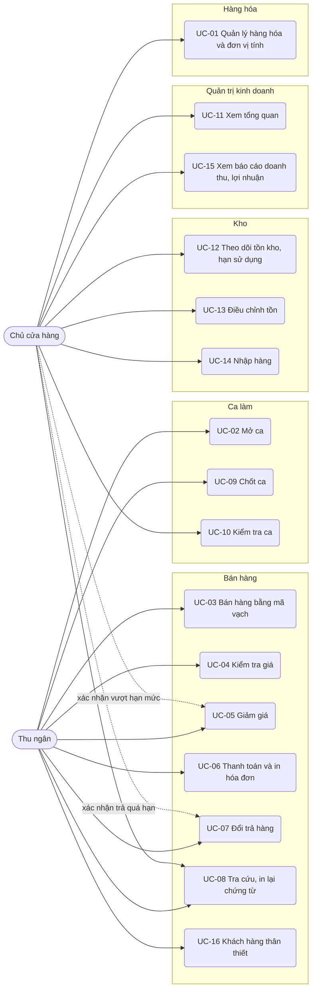
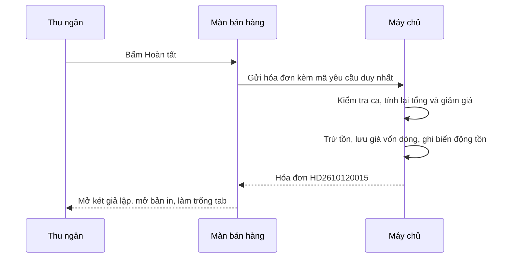
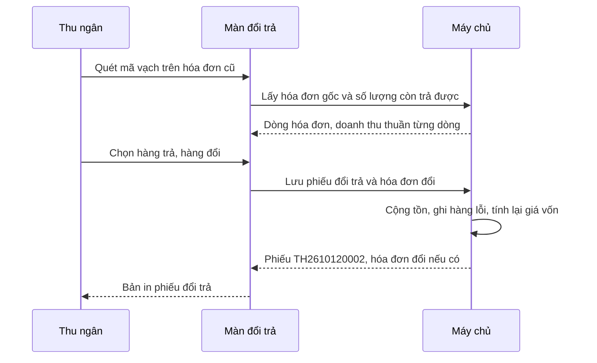

# Đặc tả use case — POS Cửa hàng Bán lẻ

> Use case phần nền (UC-SYS-01 đến UC-SYS-10): `ZDOCS/03-KIEN-TRUC/USE-CASE-NEN.md`.
> Mã FR, BR, SCR tham chiếu `02-SRS.md`.

---

## 1. Tác nhân

| Tác nhân | Mã vai trò | Use case chính |
| :--- | :--- | :--- |
| Thu ngân | `CASHIER` | UC-02, UC-03, UC-04, UC-05, UC-06, UC-07, UC-08, UC-09, UC-16 |
| Chủ cửa hàng | `MANAGER` | UC-01, UC-05 (xác nhận), UC-07 (xác nhận), UC-08, UC-10, UC-11, UC-12, UC-13, UC-14, UC-15 |
| Quản trị viên | `ADMIN` | Toàn bộ, cộng phần nền |

---

## 2. Sơ đồ use case

---

## 3. Danh sách use case

| Mã | Tên | Tác nhân chính | Module | Ưu tiên | FR |
| :--- | :--- | :--- | :--- | :---: | :--- |
| UC-01 | Quản lý hàng hóa và đơn vị tính | Chủ cửa hàng | Hàng hóa | P1 | FR-03, FR-04, FR-05, FR-06, FR-07 |
| UC-02 | Mở ca | Thu ngân | Ca làm | P1 | FR-27 |
| UC-03 | Bán hàng bằng mã vạch | Thu ngân | Bán hàng | P1 | FR-08, FR-09, FR-10, FR-11, FR-12, FR-13 |
| UC-04 | Kiểm tra giá | Thu ngân | Bán hàng | P2 | FR-14 |
| UC-05 | Giảm giá | Thu ngân | Bán hàng | P1 | FR-15, FR-16 |
| UC-06 | Thanh toán và in hóa đơn | Thu ngân | Bán hàng | P1 | FR-17, FR-18, FR-19, FR-20 |
| UC-07 | Đổi trả hàng | Thu ngân | Bán hàng | P1 | FR-22, FR-23, FR-24, FR-25, FR-26 |
| UC-08 | Tra cứu, in lại chứng từ | Thu ngân, Chủ cửa hàng | Bán hàng | P2 | FR-21 |
| UC-09 | Chốt ca | Thu ngân | Ca làm | P1 | FR-28 |
| UC-10 | Kiểm tra ca | Chủ cửa hàng | Ca làm | P1 | FR-29 |
| UC-11 | Xem tổng quan | Chủ cửa hàng | Quản trị kinh doanh | P1 | FR-01, FR-02 |
| UC-12 | Theo dõi tồn kho, hạn sử dụng | Chủ cửa hàng | Kho | P2 | FR-30, FR-31, FR-32 |
| UC-13 | Điều chỉnh tồn | Chủ cửa hàng | Kho | P2 | FR-33 |
| UC-14 | Nhập hàng | Chủ cửa hàng | Kho | P2 | FR-34, FR-35 |
| UC-15 | Xem báo cáo doanh thu, lợi nhuận | Chủ cửa hàng | Quản trị kinh doanh | P2 | FR-36, FR-37, FR-38, FR-39 |
| UC-16 | Khách hàng thân thiết | Thu ngân | Bán hàng | P3 | FR-40 |

---

## 4. Đặc tả chi tiết

### UC-01: Quản lý hàng hóa và đơn vị tính

| Mục | Nội dung |
| :--- | :--- |
| Tác nhân chính | Chủ cửa hàng |
| Mô tả | Thêm, sửa mặt hàng, nhóm hàng, đơn vị quy đổi, mã vạch, giá bán |
| Ưu tiên | P1 |
| Điều kiện kích hoạt | Có hàng mới về, nhà sản xuất đổi bao bì hoặc mã vạch, cửa hàng đổi giá |
| Tiền điều kiện | Có quyền `products.create` hoặc `products.update` |
| Hậu điều kiện | Máy bán hàng quét được mã mới và dùng giá mới sau lần làm mới danh mục kế tiếp (tối đa 5 phút, NFR-02) |
| Yêu cầu liên quan | FR-03, FR-04, FR-05, FR-06, FR-07, BR-01, BR-03, BR-04, BR-25, BR-29 |
| Màn hình | SCR-09 |

**Luồng chính (thêm mặt hàng có đơn vị quy đổi)**

1. Chủ cửa hàng mở Hàng hóa, tab Mặt hàng; hệ thống hiển thị danh sách gồm mã hàng, tên, nhóm, đơn vị cơ bản, giá bán, giá vốn bình quân, biên lãi, tồn, trạng thái.
2. Chủ cửa hàng bấm "Thêm mặt hàng".
3. Nhập tên, chọn nhóm, nhập đơn vị cơ bản (vd Lon), quét hoặc gõ mã vạch, nhập giá bán, giá vốn ban đầu, tồn tối thiểu; bật hoặc tắt "Quản lý hạn sử dụng", "Cho đổi trả".
4. Ở mục "Đơn vị quy đổi", bấm "Thêm đơn vị", nhập tên (Lốc 6), hệ số (6), mã vạch, giá bán. Hệ thống hiện giá tham khảo = giá đơn vị cơ bản × hệ số để so sánh.
5. Bấm "Lưu"; hệ thống kiểm tra BR-03, BR-04, sinh mã hàng `SP` + 5 số; mặt hàng xuất hiện trong danh sách với tồn 0, trạng thái Hết hàng.

**Luồng thay thế**

- 1a. Quản lý nhóm hàng: tab Nhóm hàng, thêm, đổi tên, kéo thả thứ tự, bật/tắt hiển thị.
- 1b. Sửa mặt hàng: chọn dòng, đổi tên, giá, mã vạch, tồn tối thiểu, lưu. Hóa đơn cũ giữ giá lúc bán.
- 1c. Ngừng bán: bật "Ngừng bán"; quét mã ở màn bán hàng báo "Hàng ngừng bán".
- 3a. Hàng chưa có mã vạch (trứng, bánh tự đóng gói): bấm "Sinh mã nội bộ", hệ thống tạo mã theo BR-03; bấm "In tem" để in tem 40×30 mm (P3).
- 4a. Giá đơn vị quy đổi lớn hơn giá tham khảo: hệ thống cảnh báo "Mua theo đơn vị lớn đắt hơn mua lẻ", vẫn cho lưu (BR-04).

**Luồng ngoại lệ**

- E1. Mã vạch đã dùng: báo lỗi tại ô, nêu tên mặt hàng và đơn vị đang dùng mã đó.
- E2. Giá không phải bội số 500 ₫, hệ số không nguyên hoặc nhỏ hơn 2, quá 3 đơn vị quy đổi: báo lỗi tại ô, không lưu.
- E3. Xóa mặt hàng đã có chứng từ, hoặc đổi hệ số của đơn vị đã bán: hệ thống từ chối, gợi ý dùng "Ngừng bán" (BR-29).

### UC-02: Mở ca

| Mục | Nội dung |
| :--- | :--- |
| Tác nhân chính | Thu ngân |
| Mô tả | Bắt đầu ca bán hàng, ghi nhận tiền đầu ca, nạp danh mục hàng về máy |
| Ưu tiên | P1 |
| Điều kiện kích hoạt | Thu ngân vào màn bán hàng khi chưa có ca đang mở |
| Tiền điều kiện | Có quyền `shifts.operate`; chưa có ca đang mở (BR-21) |
| Hậu điều kiện | Ca "Đang mở"; màn bán hàng và chức năng đổi trả mở khóa |
| Yêu cầu liên quan | FR-27, BR-21 |
| Màn hình | SCR-06 |

**Luồng chính**

1. Thu ngân mở Bán hàng; hệ thống thấy chưa có ca, hiển thị hộp "Mở ca".
2. Thu ngân đếm tiền lẻ trong két, nhập tiền đầu ca (mặc định 500.000 ₫ theo cài đặt, sửa được).
3. Bấm "Mở ca"; hệ thống tạo ca mã `CA` + ngày + số thứ tự, ghi giờ mở, nạp danh mục hàng, đơn vị, giá về máy.
4. Màn bán hàng sẵn sàng, con trỏ ở ô quét.

**Luồng thay thế**

- 1a. Thu ngân mở ca từ menu Ca làm thay vì từ màn bán hàng: các bước như trên, xong hệ thống chuyển sang Bán hàng.
- 2a. Tiền đầu ca khác mức mặc định quá 100.000 ₫: hệ thống hỏi lại "Tiền đầu ca khác mức thường ngày, xác nhận?" để tránh gõ nhầm số 0.

**Luồng ngoại lệ**

- E1. Tiền đầu ca âm hoặc để trống: báo lỗi.
- E2. Thu ngân đã có ca đang mở ở máy khác: hệ thống mở tiếp ca đó, không tạo ca mới; hóa đơn chờ của máy cũ không chuyển sang (BR-11).

### UC-03: Bán hàng bằng mã vạch

| Mục | Nội dung |
| :--- | :--- |
| Tác nhân chính | Thu ngân |
| Mô tả | Quét mã vạch hoặc tìm tên để lập hóa đơn, phục vụ song song nhiều khách bằng hóa đơn chờ |
| Ưu tiên | P1 |
| Điều kiện kích hoạt | Khách mang hàng ra quầy |
| Tiền điều kiện | Ca đang mở; danh mục đã nạp về máy |
| Hậu điều kiện | Hóa đơn đang tạo có ít nhất một dòng, sẵn sàng thanh toán |
| Yêu cầu liên quan | FR-08, FR-09, FR-10, FR-11, FR-12, FR-13, BR-05, BR-06, BR-07, BR-10, BR-11 |
| Màn hình | SCR-02 |

**Luồng chính**

1. Màn bán hàng hiển thị tab "Hóa đơn 1", ô quét có con trỏ, giỏ trống.
2. Thu ngân quét mã vạch trên sản phẩm; máy quét gửi dãy số kèm Enter.
3. Hệ thống tìm mã trong mọi đơn vị của mọi mặt hàng đang bán, thêm dòng gồm tên hàng, đơn vị, đơn giá, số lượng 1, thành tiền (BR-05, BR-06), phát tiếng bíp ngắn.
4. Thu ngân quét cùng mã lần nữa; số lượng của dòng đó tăng 1.
5. Với hàng khách lấy nhiều, thu ngân gõ `12*` rồi quét; hệ thống thêm 12 đơn vị một lần.
6. Sau mỗi lần quét, tổng số lượng và tổng tiền cập nhật, con trỏ trở về ô quét.
7. Quét xong, thu ngân bấm F9 hoặc "Thanh toán" để sang UC-06.

**Luồng thay thế**

- 2a. Hàng không có mã hoặc mã bị mờ: thu ngân bấm F2, gõ tên không dấu (vd "tom chua cay"), chọn dòng gợi ý đúng đơn vị.
- 4a. Sửa số lượng: bấm vào ô số lượng của dòng, nhập số mới.
- 4b. Đổi đơn vị: chọn đơn vị khác trong danh sách của dòng; số lượng giữ nguyên, giá theo đơn vị mới (BR-06).
- 4c. Xóa dòng: bấm biểu tượng xóa hoặc phím Delete trên dòng đang chọn.
- 6a. Khách đứng sau cần tính trước: thu ngân bấm F6 mở tab hóa đơn chờ mới; quay lại tab cũ bằng chuột hoặc F7 (BR-11).
- 6b. Khách không mua nữa: bấm "Xóa hóa đơn", xác nhận.

**Luồng ngoại lệ**

- E1. Mã không tìm thấy: âm báo lỗi, thông báo "Không tìm thấy mã vạch {mã}", không thêm dòng, ô quét được xóa trắng để quét lại.
- E2. Hàng ngừng bán: thông báo "Hàng ngừng bán", không thêm dòng.
- E3. Số lượng vượt tồn: dòng tô cam "Vượt tồn {n} {đơn vị cơ bản}"; nếu cài đặt tắt "Cho phép bán âm kho" thì nút Thanh toán bị khóa (BR-10).
- E4. Đã đủ 5 tab: F6 báo "Tối đa 5 hóa đơn chờ".
- E5. Tiền tố `n*` không hợp lệ (0, lớn hơn 999, có chữ): báo lỗi, bỏ tiền tố, không thêm dòng.

### UC-04: Kiểm tra giá

| Mục | Nội dung |
| :--- | :--- |
| Tác nhân chính | Thu ngân |
| Mô tả | Trả lời khách hỏi giá, hỏi còn hàng mà không làm thay đổi giỏ |
| Ưu tiên | P2 |
| Yêu cầu liên quan | FR-14, BR-02 |
| Màn hình | SCR-02 |

**Luồng chính**

1. Thu ngân bấm F3; hệ thống mở hộp "Kiểm tra giá", con trỏ ở ô quét của hộp.
2. Thu ngân quét mã bất kỳ đơn vị nào của mặt hàng.
3. Hệ thống hiển thị tên hàng, giá mọi đơn vị, tồn hiện tại theo cách đọc quy đổi (BR-02); giỏ hàng không đổi.
4. Esc để đóng, con trỏ trở về ô quét chính.

### UC-05: Giảm giá

| Mục | Nội dung |
| :--- | :--- |
| Tác nhân chính | Thu ngân |
| Tác nhân phụ | Chủ cửa hàng (xác nhận vượt hạn mức hoặc bán dưới giá vốn) |
| Mô tả | Giảm giá dòng hoặc hóa đơn, kiểm soát hạn mức và giá vốn |
| Ưu tiên | P1 |
| Điều kiện kích hoạt | Khách quen, hàng móp méo, hàng cận hạn sử dụng |
| Tiền điều kiện | Hóa đơn có ít nhất một dòng; có quyền `orders.discount` |
| Hậu điều kiện | Giảm giá ghi vào hóa đơn kèm lý do và người xác nhận (nếu có) |
| Yêu cầu liên quan | FR-15, FR-16, BR-07, BR-08, BR-09 |
| Màn hình | SCR-02 |

**Luồng chính (giảm giá hóa đơn)**

1. Thu ngân bấm F8 hoặc "Giảm giá".
2. Chọn kiểu phần trăm hoặc số tiền, nhập giá trị, chọn lý do (Khách quen, Hàng móp méo, Cận hạn sử dụng, Khác kèm ghi chú).
3. Hệ thống tính số tiền giảm theo BR-07, kiểm tra hạn mức 5% (BR-08) và giá vốn (BR-09).
4. Đạt cả hai điều kiện: hệ thống áp ngay, giỏ hiện dòng "Giảm giá hóa đơn" và tổng mới.

**Luồng thay thế**

- 1a. Giảm theo dòng: chọn dòng, bấm "Giảm giá dòng", tiếp tục bước 2.
- 3a. Vượt hạn mức hoặc dưới giá vốn: hệ thống mở hộp "Chủ cửa hàng xác nhận", nêu rõ lý do (vd "Giảm 7,3%, vượt hạn mức 5%" hoặc "Thấp hơn giá vốn 3.000 ₫"); chủ cửa hàng nhập tên đăng nhập, mật khẩu; tài khoản có quyền `orders.discount-override` thì hệ thống áp giảm và ghi tên người xác nhận.
- 4a. Gỡ giảm giá: bấm dấu X trên dòng giảm giá.

**Luồng ngoại lệ**

- E1. Số tiền giảm lớn hơn tổng tiền hàng: báo lỗi, không áp.
- E2. Tài khoản xác nhận không có quyền hoặc sai mật khẩu: từ chối, hóa đơn giữ nguyên.
- E3. Thu ngân thêm hoặc bớt hàng sau khi đã giảm: hệ thống tính lại; nếu điều kiện xác nhận thay đổi so với lúc đã duyệt thì gỡ giảm giá và yêu cầu làm lại.

### UC-06: Thanh toán và in hóa đơn

| Mục | Nội dung |
| :--- | :--- |
| Tác nhân chính | Thu ngân |
| Mô tả | Thu tiền mặt, chuyển khoản hoặc thẻ; tạo hóa đơn, trừ tồn, ghi giá vốn, in bill |
| Ưu tiên | P1 |
| Điều kiện kích hoạt | Thu ngân bấm F9 hoặc "Thanh toán" |
| Tiền điều kiện | Hóa đơn hợp lệ (UC-03); ca đang mở |
| Hậu điều kiện | Hóa đơn có mã theo §5.3; tồn giảm theo số lượng quy đổi; giá vốn từng dòng được lưu; tab trở về trống |
| Yêu cầu liên quan | FR-17, FR-18, FR-19, FR-20, BR-01, BR-12, BR-13, BR-14, BR-16 |
| Màn hình | SCR-03, SCR-04 |

**Luồng chính (tiền mặt)**

1. Thu ngân bấm F9; hệ thống mở hộp thanh toán với tổng cần thu, phương thức mặc định Tiền mặt, các mức gợi ý theo BR-12.
2. Thu ngân bấm một mức gợi ý hoặc gõ tiền khách đưa.
3. Hệ thống hiển thị tiền thối.
4. Thu ngân bấm Enter hoặc "Hoàn tất"; hệ thống tạo hóa đơn, trừ tồn theo số lượng quy đổi (BR-01), lưu giá vốn từng dòng (BR-13), phân bổ giảm giá (BR-14), ghi biến động tồn, gửi lệnh mở két (giả lập: thông báo "Đã mở két").
5. Hệ thống mở bản in hóa đơn có mã vạch của mã hóa đơn; tab hiện tại trở về trống, con trỏ về ô quét.

**Luồng thay thế**

- 2a. Chuyển khoản: chọn "Chuyển khoản"; hệ thống hiển thị QR có số tiền, nội dung là mã hóa đơn dự kiến; khách quét và chuyển; thu ngân bấm "Đã nhận tiền"; tiếp tục bước 4, không mở két.
- 2b. Thẻ: chọn "Thẻ"; thu ngân quẹt thẻ trên máy POS của ngân hàng, nhập mã chuẩn chi (không bắt buộc), bấm "Đã quẹt thành công"; tiếp tục bước 4, không mở két.
- 5a. Khách không lấy bill: thu ngân đóng bản in; hóa đơn vẫn được lưu, in lại ở UC-08.

**Luồng ngoại lệ**

- E1. Tiền khách đưa nhỏ hơn tổng: nút "Hoàn tất" bị khóa, hiện "Còn thiếu {số tiền}".
- E2. Mất kết nối khi bấm "Hoàn tất" (chế độ `api`): giỏ giữ nguyên, báo "Chưa lưu được hóa đơn, thử lại"; thử lại không tạo trùng hóa đơn, không trừ tồn hai lần (NFR-06).
- E3. Còn dòng vượt tồn khi cài đặt tắt "Cho phép bán âm kho": hộp thanh toán không mở được (BR-10).

### UC-07: Đổi trả hàng

| Mục | Nội dung |
| :--- | :--- |
| Tác nhân chính | Thu ngân |
| Tác nhân phụ | Chủ cửa hàng (xác nhận trả quá 7 ngày hoặc hoàn trên 500.000 ₫) |
| Mô tả | Nhận lại hàng khách đã mua, hoàn tiền hoặc đổi sang hàng khác |
| Ưu tiên | P1 |
| Điều kiện kích hoạt | Khách mang hàng và hóa đơn quay lại quầy |
| Tiền điều kiện | Ca đang mở; có quyền `returns.create` |
| Hậu điều kiện | Có phiếu đổi trả mã `TH…`; tồn, sổ hàng lỗi, tiền mặt của ca được cập nhật; nếu có hàng đổi thì có thêm một hóa đơn mới gắn với phiếu |
| Yêu cầu liên quan | FR-22, FR-23, FR-24, FR-25, FR-26, BR-14, BR-17, BR-18, BR-19, BR-20, BR-21, BR-23 |
| Màn hình | SCR-05, SCR-03 |

**Luồng chính (trả hàng, hoàn tiền mặt)**

1. Thu ngân mở Đổi trả, bấm "Tạo phiếu đổi trả".
2. Thu ngân quét mã vạch in cuối hóa đơn của khách hoặc gõ mã hóa đơn.
3. Hệ thống hiển thị hóa đơn gốc: ngày mua, số ngày đã qua, từng dòng với số lượng đã mua, đã trả, còn trả được, đơn giá thực thu; dòng hàng không cho đổi trả bị mờ.
4. Thu ngân chọn dòng, nhập số lượng trả, chọn tình trạng (Bán lại được, Hàng lỗi) và lý do (Khách đổi ý, Mua nhầm, Lỗi nhà sản xuất, Hết hạn, Khác).
5. Hệ thống tính tiền hoàn từng dòng và tổng theo BR-18.
6. Thu ngân chọn hình thức hoàn (tiền mặt hoặc chuyển khoản), bấm "Hoàn tất".
7. Hệ thống lưu phiếu, cộng tồn hàng bán lại được, ghi sổ hàng lỗi (BR-19), mở bản in phiếu đổi trả có chỗ ký của khách.

**Luồng thay thế**

- 2a. Khách mất hóa đơn: thu ngân bấm "Tìm hóa đơn", lọc theo ngày mua và mặt hàng; hệ thống chỉ hiện hóa đơn trong 30 ngày, mỗi dòng gồm mã, giờ bán, tổng tiền; thu ngân chọn đúng hóa đơn theo lời khách rồi tiếp tục bước 3.
- 4a. Đổi hàng: bấm "Thêm hàng đổi", quét hàng mới; hệ thống tính chênh lệch theo BR-20. Chênh lệch dương thì mở hộp thanh toán với số tiền chênh lệch; âm thì hoàn phần chênh; bằng 0 thì lưu luôn.
- 5a. Hóa đơn từ 8 đến 30 ngày, hoặc tổng tiền hoàn trên 500.000 ₫: hệ thống mở hộp "Chủ cửa hàng xác nhận" như UC-05; tài khoản có quyền `returns.override` thì tiếp tục bước 6.

**Luồng ngoại lệ**

- E1. Hóa đơn quá 30 ngày: hệ thống báo "Hóa đơn đã quá 30 ngày, không nhận đổi trả", không cho chọn dòng.
- E2. Số lượng trả lớn hơn số lượng còn trả được: ô báo đỏ, không cho lưu.
- E3. Dòng hàng không cho đổi trả: dòng mờ, chú thích "Hàng không đổi trả".
- E4. Mã hóa đơn không tồn tại hoặc hóa đơn đã trả hết: báo lỗi tương ứng.
- E5. Tiền hoàn bằng tiền mặt lớn hơn tiền mặt lý thuyết hiện tại của ca: hệ thống cảnh báo "Tiền mặt trong két có thể không đủ", gợi ý hoàn bằng chuyển khoản.

### UC-08: Tra cứu, in lại chứng từ

| Mục | Nội dung |
| :--- | :--- |
| Tác nhân chính | Thu ngân, Chủ cửa hàng |
| Mô tả | Tìm hóa đơn, phiếu đổi trả đã lập; xem chi tiết; in lại |
| Ưu tiên | P2 |
| Yêu cầu liên quan | FR-21, BR-15 |
| Màn hình | SCR-08, SCR-05, SCR-04 |

**Luồng chính**

1. Mở Danh sách hóa đơn; thu ngân thấy hóa đơn trong ca của mình, chủ cửa hàng thấy tất cả.
2. Tìm theo mã hoặc lọc theo khoảng thời gian, thu ngân, phương thức, trạng thái trả hàng.
3. Chọn hóa đơn để xem chi tiết dòng, thanh toán và các phiếu đổi trả liên quan.
4. Bấm "In lại"; bản in có dòng "IN LẠI" và thời điểm in lại. Phiếu đổi trả tra cứu và in lại tương tự ở màn Đổi trả.

### UC-09: Chốt ca

| Mục | Nội dung |
| :--- | :--- |
| Tác nhân chính | Thu ngân |
| Mô tả | Kết thúc ca, đối soát tiền mặt, in báo cáo ca |
| Ưu tiên | P1 |
| Điều kiện kích hoạt | Hết giờ làm hoặc giao ca |
| Tiền điều kiện | Ca đang mở |
| Hậu điều kiện | Ca "Đã chốt" hoặc "Cần kiểm tra"; không bán được cho tới khi mở ca mới |
| Yêu cầu liên quan | FR-28, BR-11, BR-21, BR-22 |
| Màn hình | SCR-06 |

**Luồng chính**

1. Thu ngân bấm "Chốt ca".
2. Hệ thống hiển thị tổng hợp: giờ mở, số hóa đơn, doanh thu theo tiền mặt, chuyển khoản, thẻ; số phiếu đổi trả, tiền hoàn theo phương thức; tiền đầu ca; tiền mặt lý thuyết (BR-21).
3. Thu ngân đếm tiền trong két, nhập số tờ theo từng mệnh giá (500.000 ₫ tới 500 ₫); hệ thống tự cộng ra tiền mặt thực đếm.
4. Hệ thống tính chênh lệch (BR-22), hiển thị màu xanh nếu không quá 20.000 ₫, màu đỏ nếu quá.
5. Thu ngân nhập ghi chú nếu có, bấm "Xác nhận chốt ca".
6. Hệ thống lưu ca, mở bản in báo cáo ca khổ 80 mm, đưa màn bán hàng về trạng thái chưa mở ca.

**Luồng thay thế**

- 1a. Còn hóa đơn chờ có hàng: hệ thống liệt kê các tab, yêu cầu thanh toán hoặc xóa trước khi chốt (BR-11).

**Luồng ngoại lệ**

- E1. Chênh lệch quá 20.000 ₫ mà không có ghi chú: hệ thống yêu cầu ghi chú trước khi xác nhận.

### UC-10: Kiểm tra ca

| Mục | Nội dung |
| :--- | :--- |
| Tác nhân chính | Chủ cửa hàng |
| Mô tả | Xem các ca, phát hiện và xử lý ca lệch tiền |
| Ưu tiên | P1 |
| Tiền điều kiện | Có quyền `shifts.view` |
| Hậu điều kiện | Ca lệch được ghi chú xử lý, chuyển "Đã kiểm tra" |
| Yêu cầu liên quan | FR-29, BR-22 |
| Màn hình | SCR-07 |

**Luồng chính**

1. Chủ cửa hàng mở Danh sách ca; mặc định hiển thị 7 ngày gần nhất, ca "Cần kiểm tra" có nhãn đỏ.
2. Chọn một ca; hệ thống hiển thị tổng hợp như lúc chốt, danh sách hóa đơn, phiếu đổi trả, các khoản giảm giá có người xác nhận.
3. Với ca "Cần kiểm tra", chủ cửa hàng nhập ghi chú xử lý, bấm "Đã kiểm tra".

**Luồng thay thế**

- 1a. Lọc theo thu ngân, trạng thái, khoảng ngày.

**Luồng ngoại lệ**

- E1. Ca đang mở: chỉ xem số liệu tạm thời, không có nút "Đã kiểm tra".

### UC-11: Xem tổng quan

| Mục | Nội dung |
| :--- | :--- |
| Tác nhân chính | Chủ cửa hàng |
| Mô tả | Nắm nhanh doanh thu, lợi nhuận hôm nay và hàng cần xử lý |
| Ưu tiên | P1 |
| Tiền điều kiện | Có quyền `reports.view` |
| Hậu điều kiện | Không thay đổi dữ liệu |
| Yêu cầu liên quan | FR-01, FR-02, BR-26, BR-27, BR-30 |
| Màn hình | SCR-01 |

**Luồng chính**

1. Chủ cửa hàng đăng nhập; hệ thống mở trang Tổng quan.
2. Hiển thị 4 thẻ số: doanh thu thuần, lợi nhuận gộp, số hóa đơn, giá trị trung bình; mỗi thẻ kèm mức tăng giảm so với cùng giờ hôm qua.
3. Hiển thị biểu đồ cột doanh thu thuần và đường lợi nhuận gộp 7 ngày, bảng top 10 mặt hàng bán chạy hôm nay.
4. Hiển thị 2 thẻ cảnh báo: số mặt hàng sắp hết (BR-26), số lô sắp hết hạn (BR-27).

**Luồng thay thế**

- 4a. Bấm thẻ cảnh báo: chuyển sang Tồn kho, lọc sẵn trạng thái tương ứng.

**Luồng ngoại lệ**

- E1. Hôm nay chưa có hóa đơn: các thẻ hiển thị 0, biểu đồ vẫn hiển thị 6 ngày trước.

### UC-12: Theo dõi tồn kho, hạn sử dụng

| Mục | Nội dung |
| :--- | :--- |
| Tác nhân chính | Chủ cửa hàng |
| Mô tả | Xem tồn, giá trị tồn, hàng sắp hết, lô sắp hết hạn, lịch sử biến động |
| Ưu tiên | P2 |
| Yêu cầu liên quan | FR-30, FR-31, FR-32, BR-02, BR-26, BR-27 |
| Màn hình | SCR-10 |

**Luồng chính**

1. Chủ cửa hàng mở Tồn kho; hệ thống hiển thị danh sách mặt hàng với tồn và cách đọc quy đổi, giá vốn bình quân, giá trị tồn, trạng thái; dòng tổng giá trị tồn ở đầu bảng.
2. Lọc "Sắp hết" để lên danh sách cần đặt hàng.
3. Chuyển tab "Sắp hết hạn"; hệ thống liệt kê lô theo BR-27: mặt hàng, phiếu nhập, ngày nhập, hạn sử dụng, số ngày còn lại, số lượng còn lại ước tính.
4. Bấm một mặt hàng để xem lịch sử biến động tồn: thời gian, chứng từ, số lượng tăng giảm, tồn sau, giá vốn sau; bấm mã chứng từ để mở chứng từ.

### UC-13: Điều chỉnh tồn

| Mục | Nội dung |
| :--- | :--- |
| Tác nhân chính | Chủ cửa hàng |
| Mô tả | Ghi giảm hàng hỏng, hết hạn, mất; sửa tồn theo số đếm thực tế |
| Ưu tiên | P2 |
| Yêu cầu liên quan | FR-33, BR-28 |
| Màn hình | SCR-10 |

**Luồng chính**

1. Ở Tồn kho, chủ cửa hàng bấm "Điều chỉnh tồn" (hoặc "Hủy lô" ở tab Sắp hết hạn, hệ thống điền sẵn mặt hàng và lý do Hết hạn).
2. Quét hoặc tìm mặt hàng, nhập số lượng thực tế; hệ thống hiển thị tồn hệ thống, chênh lệch, giá trị chênh (BR-28).
3. Chọn lý do, nhập ghi chú, bấm "Lưu".
4. Hệ thống tạo phiếu `DC…`, cập nhật tồn, ghi biến động tồn; giá vốn bình quân giữ nguyên.

### UC-14: Nhập hàng

| Mục | Nội dung |
| :--- | :--- |
| Tác nhân chính | Chủ cửa hàng |
| Mô tả | Ghi nhận hàng nhà cung cấp giao, tăng tồn, cập nhật giá vốn, rà lại giá bán |
| Ưu tiên | P2 |
| Yêu cầu liên quan | FR-34, FR-35, BR-01, BR-23, BR-24, BR-25, BR-27 |
| Màn hình | SCR-11, SCR-12 |

**Luồng chính**

1. Chủ cửa hàng mở Nhập hàng, bấm "Tạo phiếu nhập".
2. Chọn nhà cung cấp (hoặc thêm nhanh tên, số điện thoại).
3. Quét mã thùng hoặc tìm tên để thêm dòng; chọn đơn vị, nhập số lượng, đơn giá nhập theo hóa đơn của nhà cung cấp, hạn sử dụng với hàng có quản lý hạn; hệ thống tính thành tiền dòng và tổng phiếu.
4. Bấm "Lưu nháp" để kiểm hàng xong mới xác nhận, hoặc bấm thẳng "Xác nhận nhập kho".
5. Hệ thống kiểm tra BR-24, tăng tồn theo số lượng quy đổi, tính lại giá vốn bình quân theo BR-23, ghi biến động tồn, chuyển phiếu sang "Đã nhập kho".
6. Hệ thống hiển thị danh sách mặt hàng có biên lãi dưới 5% sau khi nhập (BR-25), mỗi dòng có ô sửa giá bán; chủ cửa hàng sửa giá và lưu ngay, hoặc bỏ qua.

### UC-15: Xem báo cáo doanh thu, lợi nhuận

| Mục | Nội dung |
| :--- | :--- |
| Tác nhân chính | Chủ cửa hàng |
| Mô tả | Phân tích doanh thu, lợi nhuận gộp theo ngày, nhóm, mặt hàng; đổi trả và hàng lỗi |
| Ưu tiên | P2 |
| Yêu cầu liên quan | FR-36, FR-37, FR-38, FR-39, BR-30 |
| Màn hình | SCR-13 |

**Luồng chính**

1. Chủ cửa hàng mở Báo cáo; mặc định tab Doanh thu, khoảng 30 ngày gần nhất.
2. Hệ thống hiển thị biểu đồ doanh thu thuần và lợi nhuận gộp theo ngày, đường kỳ trước làm nền, bảng số liệu bên dưới gồm doanh thu bán, tiền hoàn, doanh thu thuần, giá vốn, lợi nhuận gộp, biên lãi gộp.
3. Chủ cửa hàng đổi khoảng ngày (Hôm nay, 7 ngày, 30 ngày, Tháng này, Tháng trước, Tùy chọn tối đa 366 ngày).
4. Chuyển sang tab Lợi nhuận theo nhóm, Theo mặt hàng, Đổi trả và hàng lỗi, Thu ngân, Phương thức; bấm "Xuất Excel" để tải báo cáo đang xem (P3).
