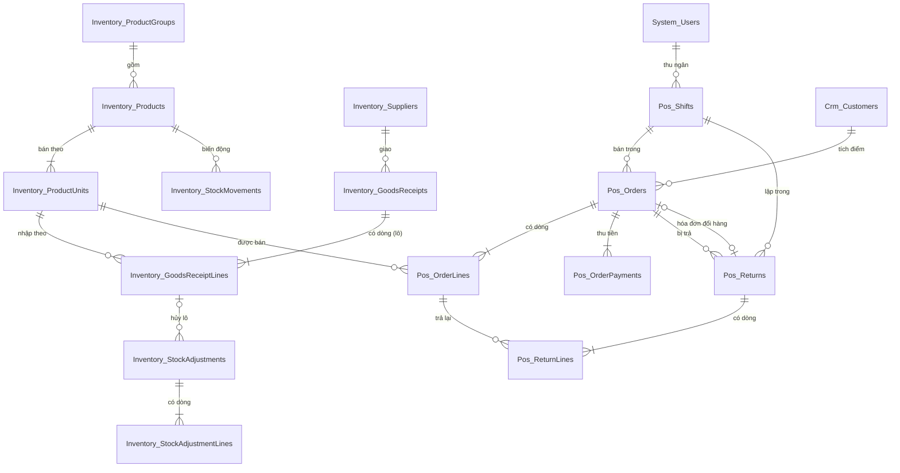

# Thiết kế CSDL — POS Cửa hàng Bán lẻ

> Database: `WebDemo_RetailPosBanLe`.
> Quy ước chung và nhóm bảng nền `System_*` (tài khoản, vai trò, quyền, cài đặt, nhật ký): xem `ZDOCS/03-KIEN-TRUC/THIET-KE-CSDL-NEN.md`.
> File này chỉ mô tả **bảng nghiệp vụ riêng của dự án**. Area theo `01` §5: `Inventory` (hàng hóa, tồn kho, nhập hàng), `Pos` (ca, hóa đơn, đổi trả), `Crm` (khách thân thiết, P3).
> Mã FR, BR, TC tham chiếu `02-SRS.md` và `05-KICH-BAN-KIEM-THU.md`. Hợp đồng API, công thức tiền: `07-DANH-SACH-API.md`.

---

## 1. Sơ đồ

---

## 2. Danh sách bảng

| Bảng | Area | Mô tả | Xóa | Dữ liệu mẫu |
| :--- | :--- | :--- | :--- | :---: |
| `Inventory_ProductGroups` | Inventory | Nhóm hàng | Không xóa, chỉ ẩn (FR-03) | 10 |
| `Inventory_Products` | Inventory | Mặt hàng, tồn, giá vốn bình quân | Mềm, chặn khi đã có chứng từ (BR-29) | 300 |
| `Inventory_ProductUnits` | Inventory | Đơn vị bán (cơ bản + tối đa 3 quy đổi), mã vạch, giá | Cứng, chặn khi đơn vị đã có chứng từ | 423 |
| `Inventory_Suppliers` | Inventory | Nhà cung cấp | Không xóa | 8 |
| `Inventory_GoodsReceipts` | Inventory | Phiếu nhập | Cứng, chỉ khi `Nhap` (BR-24) | 40 |
| `Inventory_GoodsReceiptLines` | Inventory | Dòng phiếu nhập, mỗi dòng hàng có HSD là một lô | Theo phiếu | 1.546 |
| `Inventory_StockAdjustments` | Inventory | Phiếu điều chỉnh tồn | Không xóa, không sửa (BR-28) | 12 |
| `Inventory_StockAdjustmentLines` | Inventory | Dòng điều chỉnh | Theo phiếu | 12 |
| `Inventory_StockMovements` | Inventory | Sổ biến động tồn (FR-32) | Không xóa | 15.654 |
| `Pos_Shifts` | Pos | Ca thu ngân | Không xóa | 180 |
| `Pos_Orders` | Pos | Hóa đơn đã thanh toán (gồm hóa đơn đổi hàng) | Không xóa, không sửa (BR-15) | 5.046 |
| `Pos_OrderLines` | Pos | Dòng hóa đơn, chụp giá, giá vốn lúc bán | Theo hóa đơn | 13.885 |
| `Pos_OrderPayments` | Pos | Khoản thu của hóa đơn (1–2 dòng) | Theo hóa đơn | 5.053 |
| `Pos_Returns` | Pos | Phiếu đổi trả | Không xóa | 80 |
| `Pos_ReturnLines` | Pos | Dòng trả; dòng `HangLoi` là sổ hàng lỗi | Theo phiếu | 80 |
| `Crm_Customers` | Crm | Khách thân thiết (P3) | Mềm | 30 |

Số hóa đơn, dòng, phiếu nhập, đổi trả là số script `FE/scripts/generate-history.mjs` sinh (hạt giống cố định), đối chiếu ở §5.5. Hóa đơn hôm nay chỉ nạp phần có giờ ≤ giờ lúc nạp (§5.3), nên `Pos_Orders` thực tế từ 4.991 đến 5.046.

Không có bảng riêng cho "Lô" và "Sổ hàng lỗi" của SRS §5.1: lô là `Inventory_GoodsReceiptLines` của hàng có HSD (BR-27), sổ hàng lỗi là `Pos_ReturnLines` có `Condition = HangLoi` (BR-19). Hóa đơn chờ chỉ nằm trên trình duyệt (SRS §5.1), không có bảng. Mã xác nhận của chủ cửa hàng giữ trong bộ nhớ máy chủ (`IMemoryCache`), không có bảng (`07` §2.5).

---

## 3. Quy ước chung của dự án

- Mọi bảng có cột chung `Id`, `CreatedAt`, `CreatedBy`, `UpdatedAt`, `UpdatedBy` theo `THIET-KE-CSDL-NEN.md` §1; bảng xóa mềm có thêm `IsDeleted`.
- **Tiền** `numeric(18,2)`, giá trị luôn là số nguyên đồng. Giá bán, giảm theo số tiền là bội số 500 ₫ (BR-04, BR-07). Giá vốn bình quân làm tròn tới 1 ₫ (BR-23). **Số lượng** `integer`: tồn, số lượng dòng, hệ số đều nguyên (BR-01). Không có hàng bán theo cân (SRS §2.4, `07` §5 quyết định 1).
- Tồn và giá vốn lưu theo **đơn vị cơ bản** ở `Inventory_Products.Stock`, `AvgCost`. Mọi chứng từ chụp `Factor` của đơn vị lúc lập để số lượng quy đổi không phụ thuộc bảng đơn vị.
- Thời gian lưu UTC; "ngày" trong mã chứng từ, báo cáo, ca, thời hạn đổi trả tính theo giờ Việt Nam (`VietnamTime.Zone`). Ngày thuần (ngày nhập, hạn sử dụng) lưu `date` (C# `DateOnly`).
- Enum lưu `int`, API trả chuỗi PascalCase không dấu; tên enum C# và chuỗi API giống nhau (bảng giá trị ở từng bảng §4, chữ hiển thị ở `FE/src/config/retail-pos-labels.ts`).
- **Mã chứng từ** (SRS §5.3, BR-16) sinh ở service trong transaction: số thứ tự trong ngày (giờ Việt Nam) = số chứng từ cùng loại đã có trong ngày + 1. Trùng mã do hai request cùng lúc → index unique báo lỗi, service thử lại tối đa 3 lần. Mã hàng `SP` + 5 số = số lớn nhất đã có + 1 (gồm hàng đã xóa mềm); mã nhà cung cấp `NCC` + 3 số tương tự; mã nhóm hàng `NH` + 2 số.
- **Mã vạch nội bộ** (BR-03): `20` + 10 số thứ tự + 1 số kiểm tra EAN-13; số thứ tự = lớn nhất trong mọi mã vạch đang có dạng `20` + 11 số + 1. Dữ liệu mẫu đã dùng 1–36 (`2000000000015` là trứng gà), mã kế tiếp `2000000000374`. Mã vạch hàng có bao bì trong dữ liệu mẫu là EAN-13 hư cấu: `8939` + 2 số nhóm + 5 số mã hàng + 1 số đơn vị (1 cơ bản, 2–4 quy đổi) + số kiểm tra.
- **Đồng thời**: `Inventory_Products` có cột `Version integer` làm concurrency token (`IsConcurrencyToken`), tăng mỗi lần đổi tồn hoặc giá vốn. Thanh toán, đổi trả, nhập kho, điều chỉnh đọc hàng hóa, tính, ghi trong một transaction; lệch `Version` thì làm lại cả nghiệp vụ (tối đa 3 lần) rồi mới báo 409.
- **Không bao giờ xóa** hóa đơn, phiếu đổi trả, ca, phiếu điều chỉnh, phiếu nhập đã nhập kho, biến động tồn. Đặt lại dữ liệu demo xóa cứng toàn bộ bảng `Inventory_*`, `Pos_*`, `Crm_*` (bảng con trước) rồi nạp lại.
- **Nhật ký** (`System_AuditLogs`): ghi cho nhóm hàng, mặt hàng, đơn vị, nhà cung cấp, phiếu nhập, phiếu điều chỉnh, sửa giá; **không** ghi cho hóa đơn, dòng, thanh toán, phiếu đổi trả, ca, biến động tồn (đánh dấu `IAuditLogExempt`): ghi rất nhiều và bản ghi đã chụp người, giờ thao tác.
- **Cài đặt** ở `System_Settings` (giá trị mẫu trong `FE/src/mock/seed/project.json`): nhóm "Cửa hàng" `Store.Name`, `Store.Address`, `Store.Phone`, `Store.TaxCode`, `Store.ReceiptFooter`, `Store.BankBin`, `Store.BankAccount`, `Store.BankAccountName`; nhóm "Bán hàng" `Pos.ReceiptPaperSize` (`80` | `58`), `Pos.AllowNegativeStock` (`true` | `false`, BR-10), `Pos.DefaultOpeningCash` (`500000`), `Pos.ReturnPolicy`. Đọc gộp qua `GET /api/store-profile`.
- **Hằng số** (không phải cài đặt), khai báo giống nhau ở BE `Domain/Entities/Pos/PosRules.cs` và FE `src/config/pos-rules.ts`: bước giá 500 ₫; hệ số 2–1.000; tối đa 3 đơn vị quy đổi; tiền tố `n*` 1–999; số lượng dòng 1–9.999; 5 hóa đơn chờ; hạn mức giảm của thu ngân 5%; đổi trả tự xử lý 0–7 ngày, tối đa 30 ngày; hoàn trên 500.000 ₫ cần xác nhận; lệch ca quá 20.000 ₫; biên lãi thấp dưới 5%; cảnh báo hạn 30 ngày; 20.000 ₫ một điểm; mã xác nhận sống 15 phút.
- **Ảnh hàng hóa**: không vẽ từng món. Mỗi mặt hàng có `ImageUrl` trỏ tới ảnh **kiểu bao bì** `/seed/products/{kiểu}.webp` (28 kiểu, danh sách ở `FE/src/config/retail-pos-labels.ts` → `productImageKinds`, ảnh ở `FE/public/seed/products/`) và `Color` (hex). Ảnh vẽ trung tính trên nền trong suốt; FE hiện ảnh trên ô tô nền bằng `Color`. Mặt hàng không có ảnh: ô màu kèm 2 chữ cái đầu tên.

---

## 4. Mô tả bảng

### `Inventory_ProductGroups`: nhóm hàng

| Cột | Kiểu | Ràng buộc | Ghi chú |
| :--- | :--- | :--- | :--- |
| `Code` | `varchar(20)` | unique | `BIA`, `MI`… trong dữ liệu mẫu; tạo qua API sinh `NH` + 2 số |
| `Name` | `varchar(100)` | bắt buộc, unique không phân biệt hoa thường | |
| `Color` | `varchar(20)` | bắt buộc | `#RRGGBB`, màu nhãn nhóm, màu mặc định của ô ảnh mặt hàng |
| `SortOrder` | `integer` | | `PUT /api/product-groups/order` đánh lại 10, 20, 30… |
| `IsHidden` | `boolean` | mặc định 0 | Ẩn khỏi bộ lọc nhóm ở màn bán hàng; hàng bên trong vẫn quét, tìm được |

### `Inventory_Products`: mặt hàng

| Cột | Kiểu | Ràng buộc | Ghi chú |
| :--- | :--- | :--- | :--- |
| `Code` | `varchar(20)` | unique trong bản ghi chưa xóa | `SP` + 5 số |
| `Name` | `varchar(200)` | bắt buộc | |
| `NameSearch` | `varchar(200)` | | Tên + mã, chữ thường, bỏ dấu (`đ` → `d`), ghi lại mỗi lần lưu; dùng tìm không dấu ở mọi provider (FR-06, NFR-04) |
| `GroupId` | `uuid` | FK `Inventory_ProductGroups`, có index | |
| `Stock` | `integer` | | Tồn theo đơn vị cơ bản, có thể âm (BR-10) |
| `AvgCost` | `numeric(18,2)` | ≥ 0 | Giá vốn bình quân đơn vị cơ bản (BR-23) |
| `MinStock` | `integer` | ≥ 0 | Tồn tối thiểu (BR-26) |
| `TrackExpiry` | `boolean` | | Quản lý hạn sử dụng: dòng nhập bắt buộc HSD (BR-24) |
| `Returnable` | `boolean` | mặc định 1 | Cho đổi trả (BR-17) |
| `Status` | `integer` | | Enum `ProductStatus` |
| `ImageUrl` | `varchar(500)` | | `/seed/products/lon.webp` hoặc `/uploads/...` |
| `Color` | `varchar(20)` | bắt buộc | Nền ô ảnh |
| `OpeningStock` | `integer` | mặc định 0 | Tồn đầu kỳ của lịch sử mẫu (dòng `TonDau` trong sổ biến động); hàng tạo qua API là 0 |
| `Version` | `integer` | concurrency token | Xem §3 |
| `IsDeleted` | `boolean` | mặc định 0 | Chỉ xóa được khi chưa có dòng hóa đơn, phiếu nhập, điều chỉnh, biến động khác `TonDau` (BR-29, TC-04) |

Enum `ProductStatus`: `0 DangBan` Đang bán, `1 NgungBan` Ngừng bán. Quét mã hàng ngừng bán → "Hàng ngừng bán" (TC-04).

Trường suy ra trong DTO (không lưu): `stockStatus` theo BR-26 (`AmKho` < 0, `HetHang` = 0, `SapHet` 0 < tồn ≤ `MinStock`, `ConHang`), `stockText` theo BR-02, `marginPct` theo BR-25, `hasDocuments`. Index: `GroupId`, `Status`, unique `Code` lọc chưa xóa.

### `Inventory_ProductUnits`: đơn vị bán

| Cột | Kiểu | Ràng buộc | Ghi chú |
| :--- | :--- | :--- | :--- |
| `ProductId` | `uuid` | FK, xóa theo mặt hàng | |
| `Name` | `varchar(50)` | bắt buộc, unique cùng `ProductId` | "Lon", "Lốc 6", "Thùng 24" |
| `Factor` | `integer` | 1 với đơn vị cơ bản; 2–1.000 với quy đổi | Không đổi được khi `EverUsed` (BR-29) |
| `Barcode` | `varchar(14)` | unique khi khác null, trên mọi đơn vị của mọi mặt hàng kể cả đã ngừng bán, đã xóa mềm | 8–14 chữ số (BR-03); trùng → 409 `errors["units[i].barcode"]` (TC-02) |
| `Price` | `numeric(18,2)` | > 0, bội số 500 | BR-04 |
| `IsBase` | `boolean` | | Đúng một dòng `IsBase` mỗi mặt hàng, `SortOrder = 0` |
| `SortOrder` | `integer` | | 0 cơ bản, 1–3 quy đổi theo thứ tự khai báo |
| `EverUsed` | `boolean` | mặc định 0 | Bật khi đơn vị xuất hiện ở dòng hóa đơn, phiếu nhập; chặn xóa, đổi hệ số |

Mã vạch là khóa tra cứu của máy quét: index unique `Barcode` (lọc khác null). Tên đơn vị dùng để đọc tồn quy đổi (BR-02): lấy **từ đầu tiên** của tên, viết thường ("Thùng 24" → "thùng").

### `Inventory_Suppliers`: nhà cung cấp

| Cột | Kiểu | Ràng buộc | Ghi chú |
| :--- | :--- | :--- | :--- |
| `Code` | `varchar(20)` | unique | `NCC` + 3 số |
| `Name` | `varchar(200)` | bắt buộc | |
| `Phone` | `varchar(20)` | | 10 số liền |
| `Address` | `varchar(300)` | | |
| `Note` | `varchar(500)` | | |

### `Inventory_GoodsReceipts`: phiếu nhập

| Cột | Kiểu | Ràng buộc | Ghi chú |
| :--- | :--- | :--- | :--- |
| `Code` | `varchar(20)` | unique | `PN` + `yyMMdd` (ngày tạo) + 3 số |
| `SupplierId` | `uuid` | FK, có index | |
| `Status` | `integer` | | Enum `GoodsReceiptStatus` |
| `ReceivedDate` | `date` | bắt buộc | Ngày nhập, mặc định hôm nay |
| `ConfirmedAt` | `timestamptz` | null | Lúc xác nhận nhập kho |
| `ConfirmedById` | `uuid` | null | |
| `CreatedByName` | `varchar(150)` | | Chụp tên người lập |
| `Note` | `varchar(500)` | | |
| `TotalAmount` | `numeric(18,2)` | | Σ `Amount` dòng, tính lại mỗi lần lưu |

Enum `GoodsReceiptStatus`: `0 Nhap` Nháp, `1 DaNhapKho` Đã nhập kho. Index `(Status, ReceivedDate)`.

### `Inventory_GoodsReceiptLines`: dòng phiếu nhập (lô)

| Cột | Kiểu | Ràng buộc | Ghi chú |
| :--- | :--- | :--- | :--- |
| `GoodsReceiptId` | `uuid` | FK, xóa theo phiếu | |
| `LineNo` | `integer` | | Thứ tự dòng; BR-23 tính lần lượt theo cột này |
| `ProductId` | `uuid` | FK, có index | |
| `UnitId` | `uuid` | FK `Inventory_ProductUnits` | |
| `UnitName` | `varchar(50)` | | Chụp |
| `Factor` | `integer` | | Chụp |
| `Quantity` | `integer` | > 0 | Theo đơn vị đã chọn |
| `UnitPrice` | `numeric(18,2)` | ≥ 0 | 0 là hàng tặng kèm (BR-24) |
| `Amount` | `numeric(18,2)` | | `UnitPrice × Quantity` |
| `ExpiryDate` | `date` | null | Bắt buộc khi hàng `TrackExpiry` lúc xác nhận, phải sau `ReceivedDate` (TC-41) |
| `CostBefore` | `numeric(18,2)` | null | Giá vốn bình quân trước dòng, ghi lúc xác nhận |
| `CostAfter` | `numeric(18,2)` | null | Sau dòng (BR-23) |

Lô (BR-27): dòng của hàng `TrackExpiry` thuộc phiếu `DaNhapKho`. Số lượng còn lại ước tính tính lúc đọc từ `Stock` hiện tại, không lưu. Index `(ProductId, ExpiryDate)`.

### `Inventory_StockAdjustments` và `Inventory_StockAdjustmentLines`: điều chỉnh tồn

| Cột (phiếu) | Kiểu | Ràng buộc | Ghi chú |
| :--- | :--- | :--- | :--- |
| `Code` | `varchar(20)` | unique | `DC` + `yyMMdd` + 3 số |
| `Reason` | `integer` | | Enum `AdjustmentReason` |
| `Note` | `varchar(500)` | | Bắt buộc khi `Khac` |
| `GoodsReceiptLineId` | `uuid` | null, FK | Lô bị hủy khi bấm "Hủy lô" (UC-13) |
| `CreatedByName` | `varchar(150)` | | |
| `TotalValue` | `numeric(18,2)` | | Σ `Value` dòng |

| Cột (dòng) | Kiểu | Ghi chú |
| :--- | :--- | :--- |
| `StockAdjustmentId` | `uuid` | FK, xóa theo phiếu |
| `ProductId` | `uuid` | FK |
| `SystemQty` | `integer` | Tồn hệ thống lúc lưu |
| `ActualQty` | `integer` | ≥ 0 |
| `Difference` | `integer` | `ActualQty − SystemQty` |
| `UnitCost` | `numeric(18,2)` | Giá vốn bình quân lúc lưu |
| `Value` | `numeric(18,2)` | `Difference × UnitCost` (BR-28) |

Enum `AdjustmentReason`: `0 Hong` Hỏng, `1 HetHan` Hết hạn, `2 Mat` Mất, `3 DemLai` Đếm lại, `4 Khac` Khác. Phiếu lưu là áp dụng ngay, không sửa, không đổi giá vốn.

### `Inventory_StockMovements`: sổ biến động tồn

| Cột | Kiểu | Ghi chú |
| :--- | :--- | :--- |
| `ProductId` | `uuid` | FK, index `(ProductId, OccurredAt)` |
| `OccurredAt` | `timestamptz` | Thời điểm chứng từ |
| `Type` | `integer` | Enum `MovementType` |
| `DocumentId` | `uuid` | null với `TonDau` |
| `DocumentCode` | `varchar(20)` | `HD…`, `TH…`, `PN…`, `DC…`; "Tồn đầu kỳ" với `TonDau` |
| `Quantity` | `integer` | Đơn vị cơ bản, dương là tăng |
| `StockAfter` | `integer` | |
| `CostAfter` | `numeric(18,2)` | Giá vốn bình quân sau biến động |
| `Seq` | `bigint` | Thứ tự ghi, để sắp ổn định khi trùng `OccurredAt` |

Mặt hàng tạo qua API (tồn đầu 0) không có dòng `TonDau`. Enum `MovementType`: `0 TonDau`, `1 BanHang` (−, mỗi dòng hóa đơn một dòng), `2 TraHang` (+, chỉ dòng `BanLaiDuoc`), `3 NhapHang` (+, mỗi dòng phiếu nhập), `4 DieuChinh` (±). Bảng chỉ thêm, không sửa; `IAuditLogExempt`.

### `Pos_Shifts`: ca thu ngân

| Cột | Kiểu | Ràng buộc | Ghi chú |
| :--- | :--- | :--- | :--- |
| `Code` | `varchar(20)` | unique | `CA` + `yyMMdd` + 2 số thứ tự ca mở trong ngày (mọi thu ngân) |
| `CashierId` | `uuid` | FK `System_Users`, index `(CashierId, Status)` | Mỗi thu ngân tối đa một ca `DangMo` (BR-21) |
| `CashierName` | `varchar(150)` | | Chụp |
| `OpenedAt` | `timestamptz` | bắt buộc, có index | |
| `ClosedAt` | `timestamptz` | null | |
| `OpeningCash` | `numeric(18,2)` | ≥ 0 | |
| `OrderCount`, `ReturnCount` | `integer` | | Ghi lúc chốt |
| `CashSales`, `TransferSales`, `CardSales`, `OffsetSales` | `numeric(18,2)` | | Σ `Pos_OrderPayments.Amount` theo phương thức, ghi lúc chốt |
| `SalesTotal` | `numeric(18,2)` | | Σ `Total` hóa đơn trong ca |
| `CashRefund`, `TransferRefund`, `OffsetRefund` | `numeric(18,2)` | | Tiền hoàn của phiếu đổi trả trong ca theo hình thức, ghi lúc chốt |
| `RefundTotal` | `numeric(18,2)` | | |
| `ExpectedCash` | `numeric(18,2)` | null | BR-21, ghi lúc chốt |
| `CountedCash` | `numeric(18,2)` | null | Σ mệnh giá × số tờ |
| `CashCountJson` | `text` | null | `[{ "denomination": 500000, "count": 1 }, …]` |
| `Difference` | `numeric(18,2)` | null | BR-22 |
| `Note` | `varchar(1000)` | | Bắt buộc khi lệch quá 20.000 ₫ |
| `Status` | `integer` | | Enum `ShiftStatus` |
| `ReviewNote` | `varchar(1000)` | | FR-29 |
| `ReviewedById` | `uuid` | null | |
| `ReviewedByName` | `varchar(150)` | | |
| `ReviewedAt` | `timestamptz` | null | |

Enum `ShiftStatus`: `0 DangMo` Đang mở, `1 DaChot` Đã chốt, `2 CanKiemTra` Cần kiểm tra, `3 DaKiemTra` Đã kiểm tra. Ca đang mở tính số tổng hợp trực tiếp từ hóa đơn, phiếu đổi trả (`GET /api/shifts/current`); chốt ca mới ghi cột.

### `Pos_Orders`: hóa đơn

| Cột | Kiểu | Ràng buộc | Ghi chú |
| :--- | :--- | :--- | :--- |
| `Code` | `varchar(20)` | unique | `HD` + `yyMMdd` + 4 số thứ tự thanh toán trong ngày |
| `ClientRequestId` | `varchar(64)` | unique khi khác null | Gửi lại cùng mã → trả hóa đơn cũ (NFR-06, TC-29) |
| `PaidAt` | `timestamptz` | bắt buộc | Doanh thu tính theo cột này |
| `ShiftId` | `uuid` | FK, có index | |
| `CashierId` | `uuid` | FK `System_Users` | |
| `CashierName` | `varchar(150)` | | Chụp, in trên bill |
| `Subtotal` | `numeric(18,2)` | | Σ `Amount` dòng |
| `LineDiscountTotal` | `numeric(18,2)` | | Σ giảm dòng |
| `OrderDiscountType` | `integer` | null | Enum `DiscountType` |
| `OrderDiscountValue` | `numeric(18,2)` | null | Phần trăm hoặc số tiền nhập |
| `OrderDiscountAmount` | `numeric(18,2)` | | Sau làm tròn BR-07 |
| `OrderDiscountReason` | `integer` | null | Enum `DiscountReason` |
| `OrderDiscountNote` | `varchar(200)` | | |
| `Total` | `numeric(18,2)` | ≥ 0 | BR-07 |
| `CostTotal` | `numeric(18,2)` | | Σ `CostAmount` dòng |
| `ApprovedById` | `uuid` | null | Chủ cửa hàng xác nhận giảm giá (FR-16) |
| `ApprovedByName` | `varchar(50)` | | Tên đăng nhập, vd `quanly` (TC-22) |
| `ApprovalReasons` | `varchar(300)` | | Câu lý do lúc xác nhận, nối bằng "; " |
| `CustomerId` | `uuid` | null, FK `Crm_Customers` | |
| `PointsEarned` | `integer` | | BR-31 |
| `ReturnStatus` | `integer` | | Enum `OrderReturnStatus`, cập nhật khi lập phiếu đổi trả |
| `ExchangeForReturnId` | `uuid` | null, unique khi khác null | Hóa đơn đổi hàng của phiếu đổi trả (BR-20) |
| `Note` | `varchar(200)` | | "HĐ mẫu A" trong dữ liệu mẫu |
| `QrContent` | `varchar(300)` | | Chuỗi QR chuyển khoản đã hiển thị |

Enum `DiscountType`: `0 PhanTram`, `1 SoTien`. Enum `DiscountReason`: `0 KhachQuen` Khách quen, `1 HangMopMeo` Hàng móp méo, `2 CanHanSuDung` Cận hạn sử dụng, `3 Khac` Khác. Enum `OrderReturnStatus`: `0 ChuaTra` (hiển thị "Đã thanh toán"), `1 TraMotPhan` Đã trả một phần, `2 TraHet` Đã trả hết. Trạng thái "Đang tạo", "Đang chờ" của SRS §5.2 chỉ có trên FE. Index `(PaidAt)`, `(ShiftId)`, `(CashierId, PaidAt)`, `(CustomerId)`.

### `Pos_OrderLines`: dòng hóa đơn

| Cột | Kiểu | Ràng buộc | Ghi chú |
| :--- | :--- | :--- | :--- |
| `OrderId` | `uuid` | FK, xóa theo hóa đơn | |
| `LineNo` | `integer` | | 1, 2, 3… thứ tự giỏ; dòng cuối nhận phần dư BR-14 |
| `ProductId` | `uuid` | FK, index `(ProductId)` | |
| `UnitId` | `uuid` | FK | |
| `ProductCode` | `varchar(20)` | | Chụp |
| `ProductName` | `varchar(200)` | | Chụp |
| `GroupId` | `uuid` | | Chụp để báo cáo theo nhóm lúc bán; không FK |
| `UnitName` | `varchar(50)` | | Chụp |
| `Factor` | `integer` | | Chụp |
| `Quantity` | `integer` | 1–9.999 | |
| `BaseQty` | `integer` | | `Quantity × Factor` |
| `UnitPrice` | `numeric(18,2)` | | Giá đơn vị lúc bán |
| `Amount` | `numeric(18,2)` | | BR-06 |
| `DiscountType`, `DiscountValue`, `DiscountReason` | `integer`, `numeric(18,2)`, `integer` | null | Giảm dòng |
| `DiscountNote` | `varchar(200)` | | |
| `DiscountAmount` | `numeric(18,2)` | | |
| `AllocatedDiscount` | `numeric(18,2)` | | BR-14 |
| `NetAmount` | `numeric(18,2)` | | Doanh thu thuần dòng |
| `UnitCost` | `numeric(18,2)` | | Giá vốn bình quân đơn vị cơ bản lúc thanh toán (BR-13) |
| `CostAmount` | `numeric(18,2)` | | `BaseQty × UnitCost` |
| `Returnable` | `boolean` | | Chụp "Cho đổi trả" |
| `ReturnedQty` | `integer` | mặc định 0 | Theo đơn vị của dòng |
| `RefundedAmount` | `numeric(18,2)` | mặc định 0 | |

### `Pos_OrderPayments`: khoản thu

| Cột | Kiểu | Ghi chú |
| :--- | :--- | :--- |
| `OrderId` | `uuid` | FK, xóa theo hóa đơn |
| `Method` | `integer` | Enum `PaymentMethod` |
| `Amount` | `numeric(18,2)` | Số tiền tính vào hóa đơn; Σ `Amount` = `Total` |
| `CashReceived` | `numeric(18,2)` | null; chỉ tiền mặt, ≥ `Amount` (BR-12) |
| `ChangeAmount` | `numeric(18,2)` | null; `CashReceived − Amount` |
| `Reference` | `varchar(100)` | Mã chuẩn chi thẻ, nội dung chuyển khoản |

Enum `PaymentMethod`: `0 TienMat` Tiền mặt, `1 ChuyenKhoan` Chuyển khoản, `2 The` Thẻ, `3 BuTruDoiHang` Bù trừ đổi hàng. Hóa đơn thường có một dòng; hóa đơn đổi hàng có dòng `BuTruDoiHang` cộng (nếu còn phải thu) một dòng phương thức khách trả thêm (TC-31).

### `Pos_Returns`: phiếu đổi trả

| Cột | Kiểu | Ràng buộc | Ghi chú |
| :--- | :--- | :--- | :--- |
| `Code` | `varchar(20)` | unique | `TH` + `yyMMdd` + 4 số |
| `ClientRequestId` | `varchar(64)` | unique khi khác null | |
| `ShiftId` | `uuid` | FK, có index | Ca của người lập |
| `CashierId` | `uuid` | FK | |
| `CashierName` | `varchar(150)` | | |
| `OrderId` | `uuid` | FK `Pos_Orders`, có index | Hóa đơn gốc |
| `RefundTotal` | `numeric(18,2)` | | Σ `RefundAmount` dòng (BR-18) |
| `OffsetAmount` | `numeric(18,2)` | | Phần trừ vào hóa đơn đổi = min(`RefundTotal`, tổng hóa đơn đổi) |
| `PayoutAmount` | `numeric(18,2)` | | `RefundTotal − OffsetAmount`, trả khách bằng `RefundMethod` |
| `RefundMethod` | `integer` | | Enum `RefundMethod`: `0 TienMat`, `1 ChuyenKhoan` |
| `ExchangeOrderId` | `uuid` | null, FK | Hóa đơn đổi hàng |
| `ApprovedById` | `uuid` | null | FR-25 |
| `ApprovedByName` | `varchar(50)` | | |
| `Note` | `varchar(500)` | | |
| `PointsDeducted` | `integer` | | BR-31 |

### `Pos_ReturnLines`: dòng trả, sổ hàng lỗi

| Cột | Kiểu | Ghi chú |
| :--- | :--- | :--- |
| `ReturnId` | `uuid` | FK, xóa theo phiếu |
| `OrderLineId` | `uuid` | FK `Pos_OrderLines`, có index |
| `ProductId` | `uuid` | FK |
| `Quantity` | `integer` | Theo đơn vị của dòng gốc, ≤ còn trả được |
| `BaseQty` | `integer` | `Quantity × Factor` dòng gốc |
| `Condition` | `integer` | Enum `ReturnCondition`: `0 BanLaiDuoc`, `1 HangLoi` |
| `Reason` | `integer` | Enum `ReturnReason`: `0 KhachDoiY`, `1 MuaNham`, `2 LoiNhaSanXuat`, `3 HetHan`, `4 Khac` |
| `Note` | `varchar(200)` | Bắt buộc khi `Khac`; TC-32 ghi "Phồng hộp" |
| `RefundAmount` | `numeric(18,2)` | BR-18 |
| `UnitCost` | `numeric(18,2)` | Giá vốn đơn vị cơ bản trên dòng gốc |
| `CostAmount` | `numeric(18,2)` | `BaseQty × UnitCost`; với `HangLoi` là giá trị hàng lỗi (BR-19) |

### `Crm_Customers`: khách thân thiết (P3)

| Cột | Kiểu | Ràng buộc | Ghi chú |
| :--- | :--- | :--- | :--- |
| `Phone` | `varchar(20)` | unique trong bản ghi chưa xóa | 10 số liền |
| `Name` | `varchar(150)` | bắt buộc | |
| `Points` | `integer` | ≥ 0 | Cộng khi thanh toán, trừ khi trả (BR-31) |
| `OrderCount` | `integer` | | |
| `TotalSpent` | `numeric(18,2)` | | Σ `Total` hóa đơn |
| `LastOrderAt` | `timestamptz` | null | |
| `IsDeleted` | `boolean` | | |

---

## 5. Dữ liệu mẫu

Nguồn duy nhất: `FE/src/mock/seed/demo-data.json` (FE mock nạp trực tiếp; BE nhúng EmbeddedResource `Seed.demo-data.json`, đọc bằng `SeedJson`). Tài khoản, quyền, cài đặt ở `project.json`. Phần viết tay: `productGroups`, `products` (trừ `openingStock`, `stock`), `suppliers`, `customers`. Phần sinh: `receipts`, `adjustments`, `shifts`, `orders`, `returns`, và `openingStock`, `stock` của hàng hóa, do `FE/scripts/generate-history.mjs` (`pnpm seed:history`, hạt giống `20261015`; chạy lại ra đúng file cũ). File ~613 KB, mỗi bản ghi một dòng (đã có trong `.prettierignore`).

Cửa hàng mẫu **Bình An Mart** (hư cấu), 57 Phan Đăng Lưu, Hải Châu, Đà Nẵng; mở 06:00–22:00, hai ca: sáng 06:0x–14:0x, chiều 14:0x–22:0x. `thungan` (Lê Thị Thu Hằng) và `thungan2` (Nguyễn Văn Phúc) đổi ca sáng/chiều theo tuần; **hôm nay cả hai ca đều là `thungan2`**, `thungan` chưa có ca để người xem tự mở ca ở quầy 2 (TC-05). `quanly` (Trần Thị Mai, Chủ cửa hàng) duyệt giảm giá vượt mức, xác nhận đổi trả quá hạn, kiểm tra ca, lập phiếu nhập.

### 5.1. Số lượng

| Dữ liệu | Số lượng | Đặc điểm |
| :--- | :---: | :--- |
| Nhóm hàng | 10 | BIA Bia, nước giải khát · MI Mì, cháo, đồ ăn liền · SUA Sữa, sản phẩm từ sữa · BANH Bánh kẹo, đồ ăn vặt · GIAVI Gia vị, dầu ăn, nước chấm · KHO Gạo, đồ khô, đồ hộp · TUOI Rau củ, trái cây, trứng · THIT Thịt cá, đồ đông lạnh · GIAT Giặt tẩy, đồ dùng gia đình · CANHAN Chăm sóc cá nhân |
| Hàng hóa | 300 | `SP00001`–`SP00300`, tên chung không nhãn hiệu; 123 đơn vị quy đổi (Lốc 6, Thùng 24, Thùng 30, Lốc 4, Thùng 48…); 55 mặt hàng có HSD; 36 hàng tươi đóng gói sẵn dùng mã nội bộ `20…`, không cho đổi trả; 4 ngừng bán (`SP00013`, `SP00044`, `SP00103`, `SP00272`); 3 biên lãi dưới 5% (`SP00077` 3,3%, `SP00148` dầu ăn 4,6%, `SP00170` gạo 4,1%) |
| Nhà cung cấp | 8 | `NCC001`–`NCC008`; `NCC008` (nước đá) chưa có phiếu nhập |
| Phiếu nhập | 40 | 38 đã nhập kho (mỗi nhà cung cấp 3–7 lần trong 90 ngày, 1.541 dòng, giá nhập = giá vốn × hệ số) + 2 nháp (hôm qua, 2 hôm trước) |
| Phiếu điều chỉnh | 12 | Hỏng 4, Hết hạn 3, Mất 2, Đếm lại 3 |
| Ca | 180 | 90 ngày × 2 ca; 6 ca lệch quá 20.000 ₫, 5 đã kiểm tra, 1 "Cần kiểm tra" chưa xử lý (ca chiều 3 hôm trước, lệch −45.000 ₫) |
| Hóa đơn | 5.046 | 4.991 trước hôm nay + 55 của cả ngày hôm nay (nạp theo giờ, §5.3); trung bình ~55 hóa đơn/ngày, đông 17–20h (NFR-07); tiền mặt ~60%, chuyển khoản ~30%, thẻ ~10%; 342 có giảm giá hóa đơn, 15 có giảm giá dòng, 33 vượt hạn mức do `quanly` duyệt; 598 gắn khách; 15 là hóa đơn đổi hàng |
| Phiếu đổi trả | 80 | 59 dòng bán lại được, 21 hàng lỗi; 6 cần `quanly` xác nhận; 15 có hàng đổi; mỗi hóa đơn gốc trả tối đa một lần |
| Khách hàng | 30 | SĐT `09350…`, điểm, số đơn tính từ hóa đơn |

### 5.2. Cấu trúc file và cách nạp suy ra trường

Ngày ghi tương đối: `d` là dayOffset (0 hôm nay, −1 hôm qua…), `t` là giờ `HH:mm` giờ Việt Nam. Thời điểm = (hôm nay + `d`) lúc `t`, đổi sang UTC. Các mảng sinh đã sắp theo (`d`, `t`); **thứ tự trong mảng là thứ tự số chứng từ trong ngày**. Tham chiếu chéo dùng **chỉ số mảng** (0-based). `Id` = `stableId(loại, khóa)` ở cả BE (`SeedIds.Stable`) và FE (`stableId` của `mock-helpers.ts`) với khóa ghi ở bảng dưới, để link giữ nguyên qua mỗi lần nạp.

| Phần | Trường trong file | Seeder và FE mock suy ra |
| :--- | :--- | :--- |
| `productGroups[]` | `code`, `name`, `color`, `sortOrder` | `Id = stableId('group', code)`, `IsHidden = false` |
| `products[]` | `code`, `name`, `group` (mã nhóm), `unit` (tên đơn vị cơ bản), `barcode` (null được), `price`, `cost`, `minStock`, `trackExpiry`, `returnable`, `active`, `image` (kiểu), `color`, `units: [{ name, factor, barcode, price }]`, `openingStock`, `stock` | `Id = stableId('product', code)`; đơn vị cơ bản là dòng `SortOrder 0`, `Id = stableId('unit', code, 0)`, quy đổi `stableId('unit', code, k)` với k = 1…3; `ImageUrl = "/seed/products/" + image + ".webp"`; `Status = active ? DangBan : NgungBan`; `AvgCost = cost`; `OpeningStock = openingStock`; `Stock = stock − Σ số lượng quy đổi của hóa đơn hôm nay đã nạp`; `EverUsed` = đơn vị có trong hóa đơn hoặc phiếu nhập mẫu |
| `suppliers[]` | `code`, `name`, `phone`, `address`, `note`, `groups` (chỉ để script chọn hàng, không lưu) | `Id = stableId('supplier', code)` |
| `customers[]` | `phone`, `name`, `createdDaysAgo` | `Id = stableId('customer', phone)`; `Points`, `OrderCount`, `TotalSpent`, `LastOrderAt` tính từ hóa đơn có `cu` (BR-31, trừ điểm phiếu trả) |
| `receipts[]` | `d`, `t`, `s` (mã NCC), `st` (`DaNhapKho` \| `Nhap`), `n` (ghi chú), `li: [[p, u, q, giá?, hsd?]]` | `Code = "PN" + yyMMdd + thứ tự 3 số trong ngày`; `Id = stableId('receipt', index)`; `ReceivedDate` = ngày `d`; `ConfirmedAt` = thời điểm (`d`, `t`) khi `DaNhapKho`; người lập `quanly`; dòng: `p` = số của mã hàng (12 → `SP00012`), `u` = chỉ số đơn vị (0 cơ bản, 1–3 quy đổi), `q` = số lượng theo đơn vị đó, `giá` vắng hoặc null = `cost × factor`, `hsd` = dayOffset của hạn sử dụng; `CostBefore = CostAfter = cost` (lịch sử mẫu không đổi giá vốn) |
| `adjustments[]` | `d`, `t`, `r` (lý do), `n`, `li: [[p, chênh lệch]]` | `Code = "DC" + yyMMdd + 3 số`; `SystemQty` = tồn chạy lại tới trước phiếu (§5.4), `ActualQty = SystemQty + chênh lệch`, `UnitCost = cost`; người lập `quanly` |
| `shifts[]` | `d`, `k` (1 sáng, 2 chiều), `c` (username), `o`, `x` (giờ mở, chốt), `oc` (tiền đầu ca), `df` (chênh lệch), `n` (ghi chú thu ngân), `rv: { n, by }` (kiểm tra) | `Code = "CA" + yyMMdd + 0k`; `Id = stableId('shift', d, k)`; tổng hợp tính từ hóa đơn, phiếu đổi trả có cùng (`d`, `k`); `ExpectedCash` theo BR-21; `CountedCash = ExpectedCash + df`; `Status` theo BR-22, có `rv` thì `DaKiemTra` (`ReviewedAt` = ngày sau 08:00, `ReviewedByName = by`); `CashCountJson` null |
| `orders[]` | `d`, `t`, `k`, `pm` (`TienMat` \| `ChuyenKhoan` \| `The`), `cash` (tiền khách đưa), `it: [[p, u, q, giảm dòng?]]`, `dc` (giảm hóa đơn), `by` (người xác nhận), `cu` (SĐT khách), `n` (ghi chú), `rx` (chỉ số phiếu đổi trả khi là hóa đơn đổi hàng) | `Code = "HD" + yyMMdd + thứ tự 4 số trong ngày`; `Id = stableId('order', index)`; ca theo (`d`, `k`), thu ngân của ca; tiền tính bằng công thức `07` §3 với giá trong file; `UnitCost = cost`; giảm `{ ty, v, r }` = `DiscountType`, giá trị, `DiscountReason`; có `by` thì `ApprovedByName = by`; thanh toán: hóa đơn thường một dòng `pm` = `Total`, tiền mặt `CashReceived = cash`; hóa đơn đổi hàng (`rx`) dòng `BuTruDoiHang` = min(tiền hoàn của phiếu, `Total`) cộng dòng `pm` cho phần còn lại nếu có; `ClientRequestId = null` |
| `returns[]` | `d`, `t`, `k`, `o` (chỉ số hóa đơn gốc), `li: [[chỉ số dòng, q, tình trạng, lý do]]`, `rm` (hình thức hoàn), `x` (chỉ số hóa đơn đổi), `by`, `n` | `Code = "TH" + yyMMdd + 4 số`; `Id = stableId('return', index)`; tiền hoàn BR-18; `OffsetAmount`, `PayoutAmount` theo BR-20; `Pos_OrderLines.ReturnedQty`, `RefundedAmount`, `Pos_Orders.ReturnStatus` cập nhật theo phiếu |

Ví dụ một dòng hóa đơn trong file: `{"d":-2,"t":"10:15","k":1,"pm":"TienMat","cash":510000,"it":[[12,2,1],[31,1,1]],"dc":{"ty":"PhanTram","v":5,"r":"KhachQuen"},"n":"HĐ mẫu A"}`.

### 5.3. Hôm nay (`d = 0`): nạp theo giờ lúc nạp

- Chỉ nạp **hóa đơn hôm nay có `t` ≤ giờ hiện tại** (giờ Việt Nam lúc nạp seed: lần đầu mở trang ở mock, lúc khởi động hoặc `POST /api/demo/reset` ở BE). Mở demo lúc 09:00 có hóa đơn từ 06:44 tới 09:00; mở lúc 20:00 có gần đủ 55 hóa đơn. Thứ tự số `HD` vẫn theo thứ tự mảng của phần đã nạp, hóa đơn mới tạo nối tiếp số lớn nhất.
- Ca hôm nay: ca có giờ mở > giờ hiện tại thì không nạp; ca có giờ chốt > giờ hiện tại thì nạp ở trạng thái **Đang mở** (không có số chốt). Vì vậy lúc demo luôn có đúng một ca `thungan2` đang mở.
- Hóa đơn hôm nay không chứa hàng dùng trong test case (`SP00012`, `31`, `45`, `48`, `58`, `77`, `102`), hàng đang sắp hết, hết hàng, âm kho; nên tồn các hàng này lúc nào cũng đúng §5.6. Không có phiếu nhập, đổi trả, điều chỉnh mẫu trong hôm nay.
- `stock` trong file là **tồn cuối hôm qua**; tồn lúc nạp = `stock` − hàng đã bán của hóa đơn hôm nay đã nạp.

### 5.4. Chạy lại tồn và sổ biến động

BE ghi `Inventory_StockMovements` khi seed; FE mock dựng sổ trong bộ nhớ bằng đúng cách này (không lưu localStorage):

1. Mỗi hàng hóa một dòng `TonDau` lúc 00:00 ngày `d = −89`, `Quantity = openingStock`, `CostAfter = cost`.
2. Gom mọi sự kiện: dòng phiếu nhập `DaNhapKho` (+ số lượng quy đổi), dòng hóa đơn (−), dòng trả `BanLaiDuoc` (+), dòng điều chỉnh (± chênh lệch). Sắp theo thời điểm, cùng thời điểm thì phiếu nhập → hóa đơn → phiếu đổi trả → điều chỉnh, cùng loại thì theo chỉ số mảng, trong chứng từ theo thứ tự dòng.
3. Cộng dồn ra `StockAfter`. Giá vốn lịch sử không đổi (`CostAfter = cost`) vì mọi phiếu nhập mẫu theo giá vốn. Tồn sau sự kiện cuối trước hôm nay bằng `stock` (script đã kiểm); không hàng nào âm trong lịch sử trừ `SP00224` "Đá viên túi 2kg" (bán đá chưa lập phiếu nhập, cuối hôm qua −3).

Script dựng phiếu nhập **ngược** từ tồn mục tiêu cuối hôm qua: đi lùi qua lịch sử, ở mỗi lần nhà cung cấp giao hàng nhập đủ phần đã bán (làm tròn theo thùng), nên tồn không âm và đúng số mục tiêu. Hàng HSD ngắn (bánh mì, sữa chua) nhập vừa đủ để chỉ lô mới nhất còn hàng.

### 5.5. Số đối chiếu (lần chạy script gần nhất)

BE và FE đối chiếu các số này để chắc hai bên nạp seed giống nhau (gọi `GET /api/reports/revenue` khoảng −89 … −1).

| Chỉ số | Giá trị |
| :--- | :--- |
| Hạt giống | `20261015` |
| Hóa đơn / dòng / khoản thu | 5.046 / 13.885 / 5.053 (gồm hôm nay cả ngày) |
| Σ tổng thanh toán 89 ngày trước hôm nay (d −89 … −1) | 681.982.500 ₫ |
| Σ giá vốn dòng hóa đơn 89 ngày | 569.933.500 ₫ |
| Σ tiền hoàn 80 phiếu / giá vốn hàng trả | 2.865.269 ₫ / 2.381.100 ₫ |
| Doanh thu thuần / lợi nhuận gộp 89 ngày | 679.117.231 ₫ / 111.564.831 ₫ (biên 16,4%) |
| 30 ngày gần nhất trước hôm nay (d −30 … −1): bán / hoàn / doanh thu thuần / lợi nhuận gộp | 246.724.000 / 701.103 / 246.022.897 / 40.107.397 ₫ |
| Hôm nay cả ngày (55 hóa đơn; không dòng nào vượt tồn cuối hôm qua) | 6.734.000 ₫ |
| Giá trị phiếu nhập (38 đã nhập + 2 nháp) | 653.412.800 ₫ |
| Giá trị tồn cuối hôm qua (Σ `stock × cost`) | 196.411.700 ₫ |
| Trạng thái tồn hàng đang bán cuối hôm qua | Âm kho 1, Hết hàng 3, Sắp hết 10, Còn hàng 282 |
| Lô (tính từ tồn cuối hôm qua) | Sắp hết hạn 8, đã hết hạn 1 |
| Dòng biến động tồn BE ghi | 15.654 (300 tồn đầu + 13.742 dòng bán trước hôm nay + 59 trả + 1.541 nhập + 12 điều chỉnh) + dòng bán hôm nay đã nạp |

Đổi tham số trong script thì chạy lại và cập nhật bảng này, §5.1 và §2.

### 5.6. Ràng buộc test (05 §1), script kiểm trước khi sinh

| Mã | Mặt hàng | Đơn vị, mã vạch, giá | Vốn | Tồn | Khác |
| :--- | :--- | :--- | :---: | :---: | :--- |
| `SP00012` | Bia lager lon 330ml | Lon `8939010001214` 18.000; Lốc 6 `8939010001221` 105.000; Thùng 24 `8939010001238` 410.000 | 15.500 | 50 | Tối thiểu 24 |
| `SP00031` | Mì gói tôm chua cay 75g | Gói `8939020003116` 4.500; Thùng 30 `8939020003123` 120.000 | 3.600 | 90 | Tối thiểu 60 |
| `SP00045` | Sữa tươi tiệt trùng có đường 180ml | Hộp `8939030004516` 8.000; Lốc 4 `8939030004523` 31.000; Thùng 48 `8939030004530` 360.000 | 6.500 | 120 | HSD; lô 40 ngày trước 96 hộp hạn +20, lô 10 ngày trước 96 hộp hạn +150 |
| `SP00048` | Sữa chua có đường hộp 100g | Hộp, Lốc 4 | 6.100 | 60 | HSD; lô 40 ngày trước 48 hộp hạn −2 (còn 12, đã hết hạn), lô 10 ngày trước 48 hộp hạn +28 |
| `SP00058` | Nước suối đóng chai 500ml | Chai `8939010005816` 5.000; Thùng 24 `8939010005823` 96.000 | 3.500 | 24 | Tối thiểu 12 |
| `SP00077` | Sữa bột trẻ em số 3 lon 850g | Hộp `8939030007715` 455.000 | 440.000 | 6 | Biên lãi 3,3% |
| `SP00102` | Trứng gà sạch hộp 10 quả | Hộp `2000000000015` 32.000 | 27.000 | 2 | Tối thiểu 5, không đổi trả |

Hóa đơn mẫu (ghi chú "HĐ mẫu A"…"HĐ mẫu E", không bị trả trong dữ liệu mẫu): A `d −2` 10:15 503.500 ₫ tiền mặt 510.000; B `d −1` 17:40 126.000 ₫ tiền mặt 200.000; C `d −10` 18:05 105.000 ₫ chuyển khoản; D `d −35` 09:20 120.000 ₫ tiền mặt 200.000; E `d −3` 19:10 820.000 ₫ chuyển khoản. Mã TC-01 (`8939010030115`, `8939010030122`, `8939010030139`) và mã TC-15 `8930000000000` chưa có trong dữ liệu.
